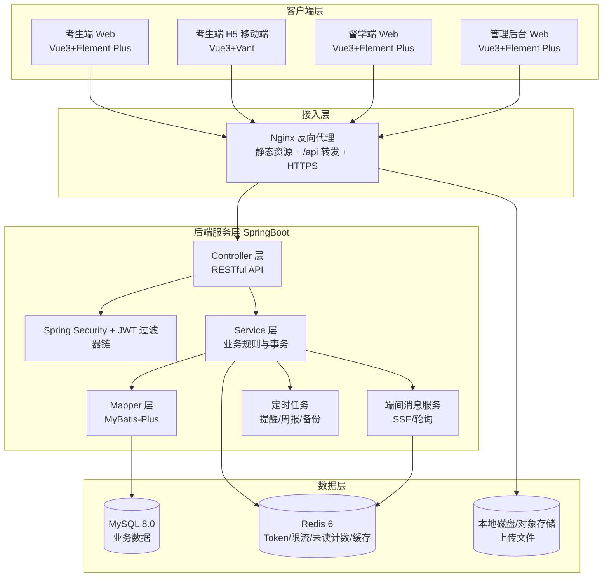
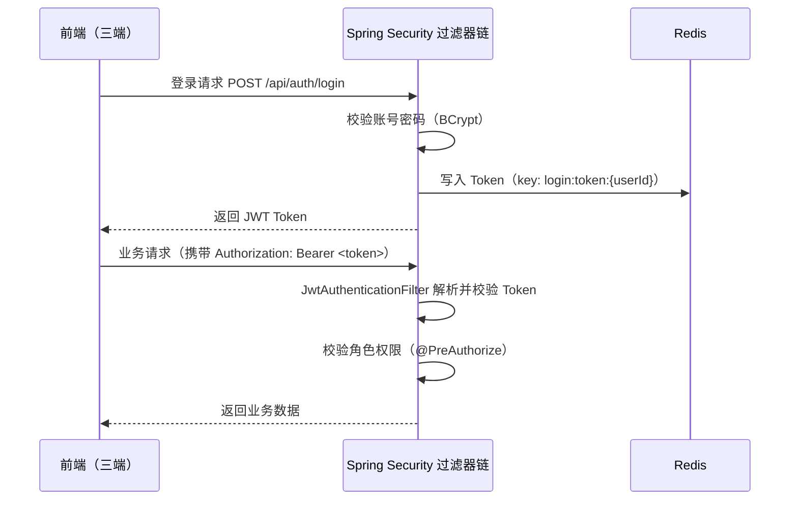
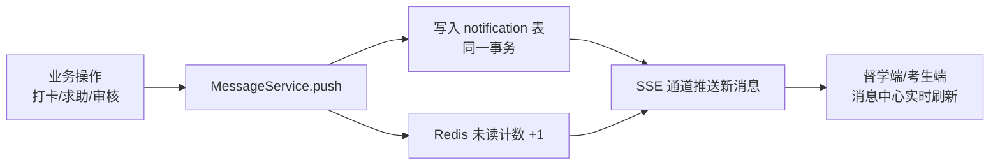
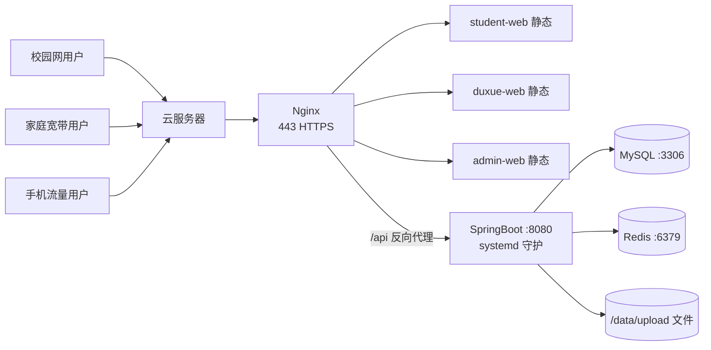

# 基于 SpringBoot 的考研考公规划与打卡系统

## 概要设计文档

| 项目名称 | 基于 SpringBoot 的考研考公规划与打卡系统 |
| --- | --- |
| 文档版本 | V1.0 |
| 编写日期 | 2026-10-16 |
| 编写人 | 郑欣宇 |
| 文档性质 | 软件工程综合实践——概要设计阶段交付物 |
| 密级 | 内部 |
| 依据文档 | 《考研考公规划与打卡系统需求分析文档》V1.2 |

---

## 1 引言

### 1.1 编写目的

本文档为"基于 SpringBoot 的考研考公规划与打卡系统"（以下简称"本系统"）的概要设计文档，旨在：

1. 确定系统的总体架构、技术选型与物理部署方案；
2. 明确模块划分、各模块职责与模块间关系；
3. 完成数据库逻辑设计（含建表 DDL）与核心接口设计；
4. 明确多端系统（考生端/督学端/管理后台）与端间消息互动的实现机制；
5. 作为详细设计、编码实现与系统测试的依据。

本文档面向的读者包括：项目开发人员、项目测试人员、指导教师、课程评审人员。

### 1.2 范围

本概要设计覆盖：总体架构设计、后端模块设计、数据库设计、接口设计、端间消息互动设计、前端设计、安全设计、部署设计与非功能设计。

### 1.3 术语

| 术语 | 说明 |
| --- | --- |
| 后端服务 | SpringBoot 单体应用，对外提供统一 RESTful API |
| 三端 | 考生端（Web+H5）、督学端（Web）、管理后台（Web） |
| 端间消息 | 一端业务行为触发后，经后端处理推送到另一端的数据消息 |
| JWT | JSON Web Token，用于接口鉴权 |
| SSE | Server-Sent Events，服务端单向推送，用于端间消息实时推送 |
| DDL | 数据库表结构定义语言 |

### 1.4 参考资料

| 编号 | 参考资料 |
| --- | --- |
| [1] | 《考研考公规划与打卡系统需求分析文档》V1.2 |
| [2] | 《软件工程综合实践》课程任务书、项目要求与验收标准 |
| [3] | Spring Boot / MyBatis-Plus / Vue 3 官方文档 |
| [4] | GB/T 8567-2006《计算机软件文档编制规范》 |

---

## 2 总体设计

### 2.1 设计目标与原则

1. **前后端分离**：三端前端与后端服务完全分离，通过 RESTful API 通信，数据变更一律经后端业务处理落库（对齐课程验收标准 1）；
2. **多端复用**：三端共用同一套后端 API 与数据库，避免接口重复开发（对齐课程验收标准 2）；
3. **低耦合高内聚**：后端按业务域划分模块，模块间通过 Service 层交互，不跨层调用；
4. **可部署性**：产物为标准 jar + 静态站点，可在云服务器一键部署，支持外网访问（对齐课程验收标准 4）；
5. **可追溯**：接口、表、功能点与需求文档编号（FR/UC）一一对应，便于团队协作与贡献追溯（对齐课程验收标准 3）。

### 2.2 系统总体架构



### 2.3 技术选型

| 层次 | 技术 | 版本/说明 |
| --- | --- | --- |
| 后端框架 | Spring Boot | 3.x |
| ORM | MyBatis-Plus | 3.5+，代码生成器 |
| 数据库 | MySQL | 8.0+，InnoDB，utf8mb4 |
| 缓存 | Redis | 6+ |
| 认证 | Spring Security + JWT | jjwt 0.11+ |
| 参数校验 | Jakarta Validation | @Valid + 自定义注解 |
| 接口文档 | springdoc-openapi (Swagger) | 可选，便于联调 |
| 定时任务 | Spring @Scheduled | 提醒、周报、备份 |
| 前端构建 | Vue 3 + Vite | 5+ |
| UI 组件 | Element Plus / Vant | 桌面端 / 移动端 H5 |
| 状态管理 | Pinia | 用户态、消息未读计数 |
| HTTP 客户端 | Axios | 拦截器统一处理 Token |
| 部署 | Nginx + systemd | 反向代理、进程守护 |

### 2.4 模块划分

| 模块 | 对应需求模块 | 主要职责 | 依赖模块 |
| --- | --- | --- | --- |
| auth（认证模块） | 用户管理 | 注册/登录/JWT 签发与校验、验证码 | user |
| user（用户模块） | 用户管理 | 用户 CRUD、个人信息、身份切换 | auth |
| goal（目标规划模块） | 目标规划 | 目标/阶段/任务/倒计时 | user |
| checkin（打卡模块） | 打卡管理 | 每日打卡/日历/补卡/连续天数 | goal、notification |
| pomodoro（番茄钟模块） | 打卡管理 | 专注计时、学习记录写入 | user |
| stats（统计模块） | 数据统计 | 打卡率/时长/科目进度/排行榜 | checkin、study_record |
| material（资料模块） | 资料与社区 | 资料上传/审核/下载 | user、notification |
| post（社区模块） | 资料与社区 | 帖子/评论/点赞/审核 | user、notification |
| follow（关注模块） | 端间消息互动 | 关注关系、动态流 | user、checkin |
| help（求助模块） | 端间消息互动 | 求助与回复 | user、notification |
| message（消息模块） | 端间消息互动/提醒 | 端间消息落库、SSE 推送、已读 | notification 表 |
| admin（管理后台模块） | 管理后台 | 用户/内容/统计/配置/审计 | 全模块 |

### 2.5 后端包结构

```
com.kaoyan.system/
├── common/                 # 通用：统一返回、异常、常量、工具类
│   ├── result/             # Result<T> 统一返回结构
│   ├── exception/          # 全局异常处理 GlobalExceptionHandler
│   └── utils/              # JwtUtils、RedisUtils、DateUtils
├── config/                 # 配置类：SecurityConfig、RedisConfig、MybatisPlusConfig
├── security/               # JWT 过滤器、登录认证、权限注解
├── module/
│   ├── auth/               # 认证 Controller/Service/Mapper
│   ├── user/
│   ├── goal/
│   ├── checkin/
│   ├── pomodoro/
│   ├── stats/
│   ├── material/
│   ├── post/
│   ├── follow/
│   ├── help/
│   ├── message/
│   └── admin/
└── task/                   # 定时任务：提醒、周报、备份
```

---

## 3 后端核心设计

### 3.1 统一返回结构与异常处理

**统一返回结构**：

```json
{ "code": 200, "message": "success", "data": {} }
```

| code | 含义 |
| --- | --- |
| 200 | 成功 |
| 400 | 参数错误 |
| 401 | 未登录/Token 失效 |
| 403 | 无权限 |
| 404 | 资源不存在 |
| 500 | 服务端异常 |

**异常处理**：`GlobalExceptionHandler` 统一捕获 `BusinessException`（业务异常，含 code/message）与系统异常，避免异常信息直接暴露给前端。

### 3.2 认证与鉴权设计（JWT）



**要点**：
1. JWT 有效期 24h（记住我 7d），Redis 存有效 Token 支持服务端注销与失效；
2. 登录失败 5 次锁定 30 分钟（Redis 计数）；
3. 接口权限用 `@PreAuthorize("hasRole('ADMIN')")` 与 `@RequireLogin` 注解控制；
4. 三端共用同一套鉴权体系，通过 Token 中 role/identity 区分考生、督学、管理员。

### 3.3 端间消息服务设计（多端核心）

**消息写入**：业务 Service 在完成主操作（打卡、求助、审核）后，调用 `MessageService.push(MessageDTO)`，在同一事务内写入 `notification` 表，并更新 Redis 未读计数（`unread:{userId}`）。

**消息推送**：督学端/考生端通过 **SSE**（`GET /api/messages/stream`）建立长连接；后端基于 Spring `SseEmitter` + 定时扫描未读消息推送；未支持 SSE 的环境退化为前端 5s 轮询 `GET /api/messages?since={lastId}`。



### 3.4 定时任务设计（task）

| 任务 | 触发规则 | 说明 |
| --- | --- | --- |
| 任务提醒 | 每日用户设定时间 | 查当日待办任务 → 写 notification 并邮件（可选） |
| 断卡提醒 | 每日 20:00 | 连续 2 天未打卡用户 → 写 notification |
| 倒计时提醒 | 每日 09:00 | 距考试 100/30/7 天 → 写 notification |
| 学习周报 | 每周一 08:00 | 汇总上周数据生成周报（notification + 报告页） |
| 数据备份 | 每日 02:00 | mysqldump 全量备份，保留 30 天 |

---

## 4 数据库设计

### 4.1 数据库总体

- 数据库名：`kaoyan_system`，字符集 `utf8mb4`，排序规则 `utf8mb4_unicode_ci`；
- 引擎统一 InnoDB，主键统一 `BIGINT` 自增；
- 时间字段统一 `DATETIME`；
- 逻辑删除：`deleted` 字段（TINYINT，0 正常/1 删除）由 MyBatis-Plus 逻辑删除插件统一处理。

### 4.2 建表 DDL（15 张表）

```sql
-- 1. 用户表
CREATE TABLE `user` (
  `id`          BIGINT       NOT NULL AUTO_INCREMENT COMMENT '用户ID',
  `username`    VARCHAR(20)  NOT NULL COMMENT '用户名',
  `password`    VARCHAR(100) NOT NULL COMMENT 'BCrypt密文',
  `email`       VARCHAR(50)  NOT NULL COMMENT '邮箱(登录凭证)',
  `phone`       VARCHAR(20)  DEFAULT NULL COMMENT '手机号(预留)',
  `nickname`    VARCHAR(30)  DEFAULT NULL COMMENT '昵称',
  `avatar_url`  VARCHAR(255) DEFAULT NULL COMMENT '头像地址',
  `intro`       VARCHAR(200) DEFAULT NULL COMMENT '个人简介',
  `exam_type`   TINYINT      DEFAULT 0 COMMENT '备考方向 0无/1考研/2考公',
  `identity`    TINYINT      DEFAULT 1 COMMENT '身份 1考生/2督学',
  `role`        TINYINT      NOT NULL DEFAULT 1 COMMENT '角色 0管理员/1普通用户',
  `status`      TINYINT      NOT NULL DEFAULT 1 COMMENT '状态 0禁用/1正常',
  `deleted`     TINYINT      NOT NULL DEFAULT 0 COMMENT '逻辑删除',
  `create_time` DATETIME     NOT NULL DEFAULT CURRENT_TIMESTAMP,
  `update_time` DATETIME     NOT NULL DEFAULT CURRENT_TIMESTAMP ON UPDATE CURRENT_TIMESTAMP,
  PRIMARY KEY (`id`),
  UNIQUE KEY `uk_username` (`username`),
  UNIQUE KEY `uk_email` (`email`),
  UNIQUE KEY `uk_phone` (`phone`)
) ENGINE=InnoDB DEFAULT CHARSET=utf8mb4 COMMENT='用户表';

-- 2. 备考目标表
CREATE TABLE `goal` (
  `id`          BIGINT      NOT NULL AUTO_INCREMENT,
  `user_id`     BIGINT      NOT NULL COMMENT '所属用户',
  `exam_type`   TINYINT     NOT NULL COMMENT '1考研/2考公',
  `target_name` VARCHAR(100) DEFAULT NULL COMMENT '目标院校/岗位',
  `major`       VARCHAR(100) DEFAULT NULL COMMENT '专业(考研)',
  `position`    VARCHAR(100) DEFAULT NULL COMMENT '岗位类型(考公)',
  `subjects`    VARCHAR(200) DEFAULT NULL COMMENT '考试科目JSON数组',
  `target_score` VARCHAR(50) DEFAULT NULL COMMENT '目标分数/分数线',
  `exam_date`   DATE        NOT NULL COMMENT '考试日期',
  `status`      TINYINT     DEFAULT 1 COMMENT '1进行中/2已结束',
  `deleted`     TINYINT     NOT NULL DEFAULT 0,
  `create_time` DATETIME    NOT NULL DEFAULT CURRENT_TIMESTAMP,
  PRIMARY KEY (`id`),
  KEY `idx_user_id` (`user_id`)
) ENGINE=InnoDB DEFAULT CHARSET=utf8mb4 COMMENT='备考目标表';

-- 3. 阶段计划表
CREATE TABLE `plan_phase` (
  `id`          BIGINT       NOT NULL AUTO_INCREMENT,
  `goal_id`     BIGINT       NOT NULL COMMENT '所属目标',
  `phase_name`  VARCHAR(50)  NOT NULL COMMENT '阶段名',
  `start_date`  DATE         NOT NULL,
  `end_date`    DATE         NOT NULL,
  `phase_target` VARCHAR(200) DEFAULT NULL COMMENT '阶段目标',
  `deleted`     TINYINT      NOT NULL DEFAULT 0,
  `create_time` DATETIME     NOT NULL DEFAULT CURRENT_TIMESTAMP,
  PRIMARY KEY (`id`),
  KEY `idx_goal_id` (`goal_id`)
) ENGINE=InnoDB DEFAULT CHARSET=utf8mb4 COMMENT='阶段计划表';

-- 4. 学习任务表
CREATE TABLE `plan_task` (
  `id`           BIGINT       NOT NULL AUTO_INCREMENT,
  `user_id`      BIGINT       NOT NULL,
  `goal_id`      BIGINT       NOT NULL,
  `phase_id`     BIGINT       DEFAULT NULL COMMENT '所属阶段可空',
  `subject`      VARCHAR(50)  NOT NULL COMMENT '科目',
  `task_content` VARCHAR(500) NOT NULL COMMENT '任务内容',
  `plan_date`    DATE         NOT NULL COMMENT '计划日期',
  `plan_duration` INT         DEFAULT NULL COMMENT '预计时长(分钟)',
  `priority`     TINYINT      DEFAULT 2 COMMENT '1高/2中/3低',
  `status`       TINYINT      DEFAULT 0 COMMENT '0未开始/1已完成/2已过期',
  `deleted`      TINYINT      NOT NULL DEFAULT 0,
  `create_time`  DATETIME     NOT NULL DEFAULT CURRENT_TIMESTAMP,
  PRIMARY KEY (`id`),
  KEY `idx_user_date` (`user_id`, `plan_date`)
) ENGINE=InnoDB DEFAULT CHARSET=utf8mb4 COMMENT='学习任务表';

-- 5. 打卡记录表
CREATE TABLE `checkin_record` (
  `id`             BIGINT   NOT NULL AUTO_INCREMENT,
  `user_id`        BIGINT   NOT NULL,
  `task_id`        BIGINT   DEFAULT NULL COMMENT '关联任务',
  `checkin_date`   DATE     NOT NULL COMMENT '打卡日期',
  `actual_duration` INT     DEFAULT NULL COMMENT '实际时长(分钟)',
  `note`           VARCHAR(200) DEFAULT NULL,
  `is_makeup`      TINYINT  DEFAULT 0 COMMENT '是否补卡',
  `create_time`    DATETIME NOT NULL DEFAULT CURRENT_TIMESTAMP,
  PRIMARY KEY (`id`),
  UNIQUE KEY `uk_user_task_date` (`user_id`, `task_id`, `checkin_date`),
  KEY `idx_user_date` (`user_id`, `checkin_date`)
) ENGINE=InnoDB DEFAULT CHARSET=utf8mb4 COMMENT='打卡记录表';

-- 6. 学习记录表
CREATE TABLE `study_record` (
  `id`          BIGINT   NOT NULL AUTO_INCREMENT,
  `user_id`     BIGINT   NOT NULL,
  `subject`     VARCHAR(50) NOT NULL,
  `duration`    INT      NOT NULL COMMENT '时长(分钟)',
  `record_date` DATE     NOT NULL,
  `source`      TINYINT  NOT NULL COMMENT '1任务打卡/2番茄钟/3手动',
  `create_time` DATETIME NOT NULL DEFAULT CURRENT_TIMESTAMP,
  PRIMARY KEY (`id`),
  KEY `idx_user_date` (`user_id`, `record_date`)
) ENGINE=InnoDB DEFAULT CHARSET=utf8mb4 COMMENT='学习记录表';

-- 7. 番茄钟记录表
CREATE TABLE `pomodoro` (
  `id`         BIGINT   NOT NULL AUTO_INCREMENT,
  `user_id`    BIGINT   NOT NULL,
  `subject`    VARCHAR(50) DEFAULT NULL,
  `duration`   INT      NOT NULL COMMENT '专注时长(分钟)',
  `start_time` DATETIME NOT NULL,
  `end_time`   DATETIME NOT NULL,
  `status`     TINYINT  DEFAULT 1 COMMENT '1完成/2中断',
  `create_time` DATETIME NOT NULL DEFAULT CURRENT_TIMESTAMP,
  PRIMARY KEY (`id`),
  KEY `idx_user_id` (`user_id`)
) ENGINE=InnoDB DEFAULT CHARSET=utf8mb4 COMMENT='番茄钟记录表';

-- 8. 资料表
CREATE TABLE `material` (
  `id`             BIGINT       NOT NULL AUTO_INCREMENT,
  `title`          VARCHAR(100) NOT NULL,
  `category`       VARCHAR(50)  NOT NULL COMMENT '分类',
  `file_url`       VARCHAR(255) NOT NULL COMMENT '文件地址',
  `uploader_id`    BIGINT       NOT NULL,
  `download_count` INT          DEFAULT 0,
  `status`         TINYINT      DEFAULT 0 COMMENT '0待审核/1已发布/2已下架',
  `deleted`        TINYINT      NOT NULL DEFAULT 0,
  `create_time`    DATETIME     NOT NULL DEFAULT CURRENT_TIMESTAMP,
  PRIMARY KEY (`id`),
  KEY `idx_category` (`category`)
) ENGINE=InnoDB DEFAULT CHARSET=utf8mb4 COMMENT='资料表';

-- 9. 帖子表
CREATE TABLE `post` (
  `id`            BIGINT       NOT NULL AUTO_INCREMENT,
  `user_id`       BIGINT       NOT NULL,
  `title`         VARCHAR(100) NOT NULL,
  `content`       TEXT         NOT NULL,
  `like_count`    INT          DEFAULT 0,
  `comment_count` INT          DEFAULT 0,
  `status`        TINYINT      DEFAULT 0 COMMENT '0待审核/1已发布/2已下架',
  `deleted`       TINYINT      NOT NULL DEFAULT 0,
  `create_time`   DATETIME     NOT NULL DEFAULT CURRENT_TIMESTAMP,
  PRIMARY KEY (`id`),
  KEY `idx_status_time` (`status`, `create_time`)
) ENGINE=InnoDB DEFAULT CHARSET=utf8mb4 COMMENT='帖子表';

-- 10. 评论表
CREATE TABLE `comment` (
  `id`          BIGINT   NOT NULL AUTO_INCREMENT,
  `post_id`     BIGINT   NOT NULL,
  `user_id`     BIGINT   NOT NULL,
  `content`     VARCHAR(500) NOT NULL,
  `deleted`     TINYINT  NOT NULL DEFAULT 0,
  `create_time` DATETIME NOT NULL DEFAULT CURRENT_TIMESTAMP,
  PRIMARY KEY (`id`),
  KEY `idx_post_id` (`post_id`)
) ENGINE=InnoDB DEFAULT CHARSET=utf8mb4 COMMENT='评论表';

-- 11. 关注关系表（多端互动）
CREATE TABLE `follow` (
  `id`          BIGINT   NOT NULL AUTO_INCREMENT,
  `follower_id` BIGINT   NOT NULL COMMENT '关注者(督学)',
  `followed_id` BIGINT   NOT NULL COMMENT '被关注者(考生)',
  `create_time` DATETIME NOT NULL DEFAULT CURRENT_TIMESTAMP,
  PRIMARY KEY (`id`),
  UNIQUE KEY `uk_follow` (`follower_id`, `followed_id`),
  KEY `idx_followed` (`followed_id`)
) ENGINE=InnoDB DEFAULT CHARSET=utf8mb4 COMMENT='关注关系表';

-- 12. 求助帖表（多端互动）
CREATE TABLE `help_post` (
  `id`            BIGINT       NOT NULL AUTO_INCREMENT,
  `user_id`       BIGINT       NOT NULL COMMENT '求助者(考生)',
  `title`         VARCHAR(100) NOT NULL,
  `content`       TEXT         NOT NULL,
  `subject`       VARCHAR(50)  DEFAULT NULL,
  `target_user_id` BIGINT      DEFAULT NULL COMMENT '@指定督学',
  `status`        TINYINT      DEFAULT 1 COMMENT '1待回复/2已回复/3已关闭',
  `deleted`       TINYINT      NOT NULL DEFAULT 0,
  `create_time`   DATETIME     NOT NULL DEFAULT CURRENT_TIMESTAMP,
  PRIMARY KEY (`id`),
  KEY `idx_user_id` (`user_id`),
  KEY `idx_target` (`target_user_id`)
) ENGINE=InnoDB DEFAULT CHARSET=utf8mb4 COMMENT='求助帖表';

-- 13. 求助回复表（多端互动）
CREATE TABLE `help_reply` (
  `id`          BIGINT   NOT NULL AUTO_INCREMENT,
  `help_id`     BIGINT   NOT NULL,
  `user_id`     BIGINT   NOT NULL,
  `content`     VARCHAR(500) NOT NULL,
  `create_time` DATETIME NOT NULL DEFAULT CURRENT_TIMESTAMP,
  PRIMARY KEY (`id`),
  KEY `idx_help_id` (`help_id`)
) ENGINE=InnoDB DEFAULT CHARSET=utf8mb4 COMMENT='求助回复表';

-- 14. 消息表（承载端间消息）
CREATE TABLE `notification` (
  `id`            BIGINT       NOT NULL AUTO_INCREMENT,
  `user_id`       BIGINT       NOT NULL COMMENT '接收者',
  `from_user_id`  BIGINT       DEFAULT NULL COMMENT '触发者',
  `type`          TINYINT      NOT NULL COMMENT '1打卡动态/2学习求助/3求助回复/4监督提醒/5审核结果/6任务提醒/7倒计时/8断卡/9系统公告',
  `content`       VARCHAR(500) NOT NULL,
  `ref_id`        BIGINT       DEFAULT NULL COMMENT '关联业务对象ID',
  `is_read`       TINYINT      DEFAULT 0 COMMENT '0未读/1已读',
  `create_time`   DATETIME     NOT NULL DEFAULT CURRENT_TIMESTAMP,
  PRIMARY KEY (`id`),
  KEY `idx_user_read` (`user_id`, `is_read`),
  KEY `idx_user_time` (`user_id`, `create_time`)
) ENGINE=InnoDB DEFAULT CHARSET=utf8mb4 COMMENT='消息表';

-- 15. 操作日志表
CREATE TABLE `audit_log` (
  `id`          BIGINT       NOT NULL AUTO_INCREMENT,
  `operator_id` BIGINT       NOT NULL COMMENT '操作人',
  `action`      VARCHAR(50)  NOT NULL COMMENT '操作',
  `target_type` VARCHAR(30)  DEFAULT NULL,
  `target_id`   BIGINT       DEFAULT NULL,
  `detail`      VARCHAR(500) DEFAULT NULL,
  `create_time` DATETIME     NOT NULL DEFAULT CURRENT_TIMESTAMP,
  PRIMARY KEY (`id`),
  KEY `idx_operator` (`operator_id`)
) ENGINE=InnoDB DEFAULT CHARSET=utf8mb4 COMMENT='操作日志表';
```

### 4.3 索引与性能设计

1. 高频查询（任务按用户+日期、消息按用户+已读、打卡唯一约束）已建组合索引；
2. 排行榜、统计查询基于 `study_record`/`checkin_record` 聚合，数据量大时用 Redis 缓存周/月榜（TTL 10 分钟）；
3. 消息表按 `user_id + create_time` 索引分页查询，单用户消息量可控；
4. 关注关系 `uk_follow` 防重复关注。

### 4.4 缓存设计（Redis）

| Key | 用途 | 过期策略 |
| --- | --- | --- |
| `login:token:{userId}` | 有效 JWT 白名单 | 24h/7d |
| `login:fail:{username}` | 登录失败计数 | 30min |
| `rate:ip:{ip}:{api}` | 接口限流 | 1min |
| `unread:{userId}` | 未读消息计数 | 常驻（随读清零） |
| `rank:{week}` / `rank:{month}` | 排行榜缓存 | 10min |
| `sms:code:{email}` | 邮箱验证码 | 10min |

---

## 5 接口设计

### 5.1 接口规范

- 风格：RESTful，基础路径 `/api`；
- 返回结构：统一 `{code, message, data}`；
- 鉴权：请求头 `Authorization: Bearer <JWT>`；
- 分页：`page`（页码，从 1 起）、`size`（每页条数，默认 10）、返回 `PageResult{total, records}`；
- 命名：资源名复数，动词用 HTTP Method 表达。

### 5.2 主要接口清单

| 模块 | 方法 | 路径 | 说明 | 权限 |
| --- | --- | --- | --- | --- |
| 认证 | POST | /api/auth/code | 发送邮箱验证码 | 公开 |
| | POST | /api/auth/register | 用户注册 | 公开 |
| | POST | /api/auth/login | 登录 | 公开 |
| | POST | /api/auth/logout | 注销（Token 失效） | 登录 |
| | POST | /api/auth/forgot-password | 找回密码 | 公开 |
| 用户 | GET | /api/user/profile | 获取个人信息 | 登录 |
| | PUT | /api/user/profile | 修改个人信息/身份 | 登录 |
| | POST | /api/user/avatar | 上传头像 | 登录 |
| | PUT | /api/user/password | 修改密码 | 登录 |
| 目标 | POST | /api/goals | 创建备考目标 | 登录 |
| | GET | /api/goals | 我的目标列表 | 登录 |
| | GET | /api/goals/{id} | 目标详情+倒计时 | 登录 |
| | PUT | /api/goals/{id} | 修改目标 | 登录 |
| | DELETE | /api/goals/{id} | 结束/删除目标 | 登录 |
| 阶段 | POST | /api/phases | 新增阶段 | 登录 |
| | GET | /api/goals/{id}/phases | 目标阶段列表 | 登录 |
| | PUT | /api/phases/{id} | 修改阶段 | 登录 |
| | DELETE | /api/phases/{id} | 删除阶段 | 登录 |
| 任务 | POST | /api/tasks | 新增任务 | 登录 |
| | GET | /api/tasks/today | 今日任务列表 | 登录 |
| | GET | /api/tasks?date= | 按日期查询 | 登录 |
| | PUT | /api/tasks/{id} | 修改任务 | 登录 |
| | DELETE | /api/tasks/{id} | 删除任务 | 登录 |
| | POST | /api/tasks/batch | 批量生成周任务 | 登录 |
| 打卡 | POST | /api/checkins | 每日打卡（触发消息推送） | 登录 |
| | GET | /api/checkins/calendar?month= | 打卡日历 | 登录 |
| | GET | /api/checkins/streak | 连续打卡天数 | 登录 |
| | POST | /api/checkins/makeup | 补卡 | 登录 |
| 番茄钟 | POST | /api/pomodoros | 开始计时 | 登录 |
| | PUT | /api/pomodoros/{id}/finish | 完成计时（写学习记录） | 登录 |
| 统计 | GET | /api/stats/overview | 个人统计总览 | 登录 |
| | GET | /api/stats/trend?type= | 学习时长趋势（日/周/月） | 登录 |
| | GET | /api/stats/subjects | 科目时长占比/进度 | 登录 |
| | GET | /api/rankings?period= | 排行榜 | 公开 |
| 资料 | GET | /api/materials | 资料列表（分类+检索） | 公开 |
| | POST | /api/materials | 上传资料 | 登录 |
| | POST | /api/materials/{id}/download | 下载计数 | 登录 |
| 社区 | GET | /api/posts | 帖子列表 | 公开 |
| | POST | /api/posts | 发布帖子 | 登录 |
| | GET | /api/posts/{id} | 帖子详情 | 公开 |
| | DELETE | /api/posts/{id} | 删除自己的帖子 | 登录 |
| | POST | /api/posts/{id}/like | 点赞 | 登录 |
| | GET | /api/posts/{id}/comments | 评论列表 | 公开 |
| | POST | /api/posts/{id}/comments | 发表评论 | 登录 |
| 关注 | POST | /api/follows | 关注考生 | 登录(督学) |
| | DELETE | /api/follows/{id} | 取关 | 登录(督学) |
| | GET | /api/follows | 我的关注列表 | 登录(督学) |
| | GET | /api/follows/feed | 关注动态流 | 登录(督学) |
| 求助 | POST | /api/helps | 发起求助（触发推送） | 登录(考生) |
| | GET | /api/helps | 我的求助/收到的求助 | 登录 |
| | POST | /api/helps/{id}/replies | 回复求助（触发推送） | 登录 |
| | PUT | /api/helps/{id}/status | 关闭求助 | 登录 |
| 消息 | GET | /api/messages?type=&page= | 消息列表 | 登录 |
| | GET | /api/messages/unread-count | 未读消息计数 | 登录 |
| | PUT | /api/messages/{id}/read | 标记已读 | 登录 |
| | PUT | /api/messages/read-all | 全部已读 | 登录 |
| | GET | /api/messages/stream | SSE 实时推送 | 登录 |
| 管理 | GET | /api/admin/users | 用户列表 | 管理员 |
| | PUT | /api/admin/users/{id}/status | 禁用/启用 | 管理员 |
| | GET | /api/admin/audits | 审计日志 | 管理员 |
| | PUT | /api/admin/materials/{id}/review | 资料审核 | 管理员 |
| | PUT | /api/admin/posts/{id}/review | 帖子审核 | 管理员 |
| | GET | /api/admin/stats | 平台统计看板 | 管理员 |
| | POST | /api/admin/notices | 发布公告 | 管理员 |

### 5.3 端间消息接口详设（多端核心）

**1. 打卡推送（POST /api/checkins）响应后**：

```json
// 后端在处理打卡成功后，同事务内推送消息
POST /api/checkins  →  写入 checkin_record  →  MessageService.push({
    userId: 督学ID(关注该考生的所有督学),
    fromUserId: 考生ID,
    type: 1,                       // 打卡动态
    content: "「昵称」已完成今日打卡，共完成3项任务，连续打卡7天",
    refId: checkinRecordId
})
```

**2. SSE 推送（GET /api/messages/stream）**：

```http
GET /api/messages/stream
Authorization: Bearer <token>
Accept: text/event-stream

// 服务端事件
data: {"id": 1024, "type": 1, "content": "「昵称」已完成今日打卡...", "unread": 5}
```

**3. 求助与回复（POST /api/helps、POST /api/helps/{id}/replies）**：同样经 `MessageService.push` 向对方端推送（type=2 求助、type=3 回复）。

---

## 6 前端设计

### 6.1 前端工程结构

采用 monorepo 三应用独立构建：

```
frontend/
├── student-web/          # 考生端（桌面 Web + H5 响应式）
│   ├── src/
│   │   ├── api/          # Axios 封装 + 模块接口
│   │   ├── views/        # 页面（首页/工作台/规划/任务/打卡/统计/资料/社区/求助）
│   │   ├── components/   # 通用组件（倒计时卡片/打卡日历/图表）
│   │   ├── store/        # Pinia（userStore / messageStore）
│   │   └── router/       # 路由（含登录守卫）
├── duxue-web/            # 督学端
│   └── src/              # 关注动态/求助处理/监督提醒/消息中心
└── admin-web/            # 管理后台
    └── src/              # 用户管理/审核/统计看板/系统配置
```

### 6.2 三端路由与页面映射

| 端 | 路由 | 页面 | 对应需求 |
| --- | --- | --- | --- |
| student-web | / | 首页（倒计时/今日任务/排行榜） | FR-07/08/19 |
| | /dashboard | 个人工作台 | FR-13/17 |
| | /plan/goal | 目标规划页 | FR-07~09 |
| | /plan/task | 任务管理页 | FR-10~12 |
| | /checkin/calendar | 打卡日历页 | FR-14/16 |
| | /stats | 数据统计页 | FR-19~23 |
| | /materials | 资料库页 | FR-24/25 |
| | /community | 社区页 | FR-26~29 |
| | /help | 求助页 | FR-32/33 |
| | /messages | 消息中心 | FR-36/37 |
| duxue-web | /feed | 关注动态页 | FR-30/31 |
| | /help/process | 求助处理页 | FR-33 |
| | /remind | 监督提醒页 | FR-34 |
| | /messages | 消息中心 | FR-36/37 |
| admin-web | /users | 用户管理 | FR-43 |
| | /review/materials | 资料审核 | FR-44 |
| | /review/posts | 帖子审核 | FR-44 |
| | /stats | 平台统计 | FR-45 |
| | /config | 系统配置 | FR-46/47 |

### 6.3 前端关键设计

1. **Axios 拦截器**：请求自动携带 Token；响应拦截统一处理 `401`（跳转登录）、`code!=200`（toast 错误）；
2. **登录守卫**：路由守卫校验本地 Token 与角色，游客仅可访问公开页面；
3. **消息实时性**：`messageStore` 挂载 SSE（`EventSource`），不支持时降级 `setInterval 5s` 轮询，未读计数红点全局展示；
4. **图表**：统计页使用 ECharts 渲染趋势图与占比图；
5. **H5 适配**：student-web 使用 Vant 组件 + 响应式布局，同一套代码在桌面/移动端自适应（`@media` 断点）。

---

## 7 安全设计

| 层面 | 设计 |
| --- | --- |
| 传输安全 | 生产环境全站 HTTPS（Nginx 证书终止），登录接口禁止明文 HTTP |
| 密码安全 | BCrypt 加盐哈希（强度 10），登录日志禁止输出密码 |
| 认证授权 | JWT + Spring Security；接口按角色注解控制，越权返回 403 |
| 防暴力破解 | 登录失败 5 次锁 30 分钟；注册/验证码接口 Redis 限流 |
| 注入防护 | MyBatis-Plus 预编译 SQL；参数使用 Validation 校验；前端输出转义防 XSS |
| 文件安全 | 上传类型白名单（jpg/png/pdf/doc/docx），大小 ≤50MB，重命名存储，禁止可执行文件 |
| 敏感词 | 帖子/求助/评论先过敏感词库，命中标记待审（先审后发） |
| 数据脱敏 | 邮箱等敏感信息界面展示部分脱敏 |
| 审计 | 管理员关键操作写入 audit_log |
| 个人信息 | 注册协议明示收集范围；账号注销功能（注销后匿名化处理） |

---

## 8 部署设计

### 8.1 部署架构



### 8.2 部署清单

| 项 | 配置 |
| --- | --- |
| 云服务器 | 2 核 4G（阿里云/腾讯云轻量），Ubuntu 22.04，开放 80/443 端口 |
| 域名/公网 IP | 绑定域名（可选），不同网络可访问 |
| JDK | OpenJDK 17 |
| MySQL | 8.0，建库 `kaoyan_system`，utf8mb4 |
| Redis | 6+，设置访问密码 |
| Nginx | 三端静态站点 + `/api` 反向代理 `http://127.0.0.1:8080`，HTTPS 证书 |
| 后端运行 | `systemd` 服务守护，`java -jar app.jar --spring.profiles.active=prod` |
| 配置文件 | `application-prod.yml` 与开发环境分离，密码等用环境变量注入 |

### 8.3 部署步骤概览

1. 服务器安装 JDK17 / MySQL / Redis / Nginx；
2. 导入建表 DDL 初始化数据库；
3. 后端 `mvn package` 生成 jar，上传服务器，配置 systemd 服务并启动；
4. 前端三个应用 `npm run build` 生成 dist，上传至 Nginx 站点目录；
5. 配置 Nginx 反向代理与 HTTPS 证书，`nginx -t && nginx -s reload`；
6. 分别用校园网、家庭宽带、手机流量访问公网地址，验证全功能（对齐验收标准 4）。

---

## 9 非功能设计

### 9.1 性能

1. 接口响应 P95 ≤ 500ms：数据库加索引、Redis 缓存热点（排行榜/未读计数）；
2. 大列表（消息/帖子）走分页 + 索引，禁止全表扫描；
3. 图片懒加载、静态资源 Nginx 直接返回并开启 gzip。

### 9.2 可靠性

1. 写操作事务：打卡+消息推送同事务，失败回滚；
2. 幂等：打卡以 `uk_user_task_date` 唯一约束防重复提交；点赞以唯一记录防重复；
3. 备份：每日 02:00 mysqldump 全量备份，保留 30 天。

### 9.3 可扩展性

1. 端间消息预留消息队列升级路径（当前轮询/SSE → RocketMQ/Kafka）；
2. 三端 API 复用，预留移动端原生 App 接入；
3. 模块化包结构，新增业务域不影响既有模块。

---

## 10 附录

### 附录 A：需求追溯映射（概要）

| 需求模块 | 后端模块 | 核心表 | 核心接口 |
| --- | --- | --- | --- |
| 用户管理 FR-01~06 | auth/user | user | /api/auth/*、/api/user/* |
| 目标规划 FR-07~12 | goal | goal/plan_phase/plan_task | /api/goals、/api/phases、/api/tasks |
| 打卡管理 FR-13~18 | checkin/pomodoro | checkin_record/study_record/pomodoro | /api/checkins、/api/pomodoros |
| 数据统计 FR-19~23 | stats | study_record | /api/stats、/api/rankings |
| 资料与社区 FR-24~29 | material/post | material/post/comment | /api/materials、/api/posts |
| 端间消息互动 FR-30~37 | follow/help/message | follow/help_post/help_reply/notification | /api/follows、/api/helps、/api/messages |
| 消息提醒 FR-38~42 | message/task | notification | /api/messages、定时任务 |
| 管理后台 FR-43~47 | admin | user/audit_log | /api/admin/* |

### 附录 B：待确认事项

| 编号 | 事项 | 建议 |
| --- | --- | --- |
| D-01 | SSE 与轮询的选择 | 首期实现 SSE，降级轮询，联调时验证校园网环境兼容性 |
| D-02 | 文件存储 | 首期本地磁盘（/data/upload），预留对象存储（OSS）切换 |
| D-03 | 部署服务器资源 | 确认团队云服务器配置与公网带宽，满足验收演示 |
| D-04 | 前端三应用是否拆仓库 | 建议同一仓库 `frontend/` 下三目录，方便团队协作与贡献统计 |

---

> 本文档为 V1.0 版本，后续根据详细设计与开发过程中的调整进行修订，修订记录见下表。

**修订记录**

| 版本 | 修订日期 | 修订人 | 修订说明 |
| --- | --- | --- | --- |
| V1.0 | 2026-10-16 | 郑欣宇 | 初稿：总体架构、模块划分、15 张表 DDL、接口清单、端间消息机制、前端工程、安全与部署设计 |
