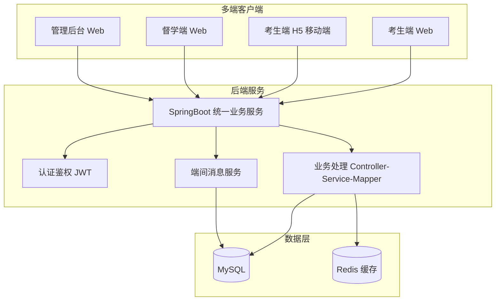
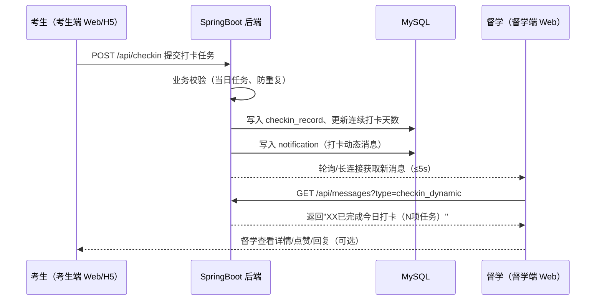
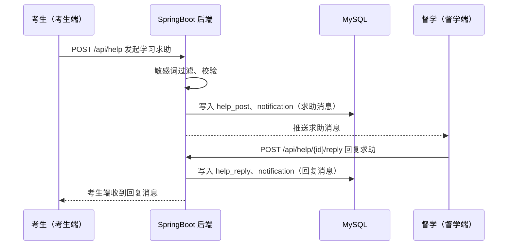
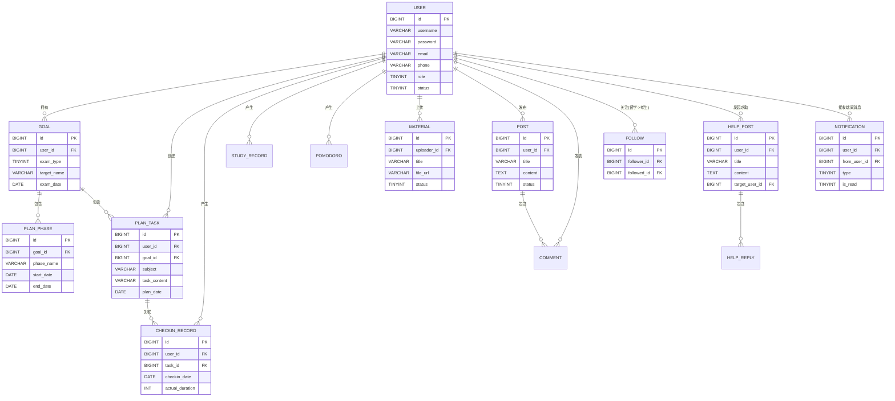

# 基于 SpringBoot 的考研考公规划与打卡系统

## 需求分析文档

| 项目名称 | 基于 SpringBoot 的考研考公规划与打卡系统 |
| --- | --- |
| 文档版本 | V1.2 |
| 编写日期 | 2026-10-16 |
| 编写人 | 郑欣宇 |
| 文档性质 | 软件工程综合实践——需求分析阶段交付物 |
| 密级 | 内部 |

---

## 1 引言

### 1.1 编写目的

本文档为"基于 SpringBoot 的考研考公规划与打卡系统"（以下简称"本系统"）的需求分析文档，旨在：

1. 明确系统的建设目标、业务范围与用户群体；
2. 完整、无歧义地描述系统的功能需求与非功能需求；
3. 作为后续概要设计、详细设计、编码实现、系统测试与验收的依据；
4. 为项目组、指导教师及评审人员提供评审与沟通的基础。

本文档面向的读者包括：项目开发人员、项目测试人员、指导教师、课程评审人员。

### 1.2 项目背景

#### 1.2.1 业务背景

近年来，考研、考公人数持续处于高位，备考周期普遍长达 6~12 个月。备考过程中，考生普遍面临以下问题：

1. **规划混乱**：缺乏科学的目标拆解方法，难以将长期目标转化为可执行的阶段计划与每日任务；
2. **执行力不足**：缺少有效的每日打卡与监督机制，容易中途放弃或"三天打鱼两天晒网"；
3. **数据无感知**：无法直观了解自己的学习时长、打卡率与科目进度，难以进行自我复盘；
4. **信息分散**：备考资料、经验分享散落在各类平台，缺乏面向考研考公场景的垂直聚合；
5. **缺乏同伴激励**：独学无友，缺少排行榜、打卡氛围等外部激励手段。

市面上通用的打卡与时间管理工具（如番茄钟、习惯养成类 App）虽具备基础打卡能力，但**不针对考研考公场景**：不支持目标院校/岗位管理、考试科目规划、考试倒计时、阶段计划等垂直功能。本系统面向公众开放，旨在填补这一细分缺口，为备考人群提供"目标—计划—执行—复盘"的一体化平台。

#### 1.2.2 课程背景

本系统为《软件工程综合实践》课程团队项目，须满足以下课程硬性要求：

1. **前后端数据库**：系统须具备完整的"前端界面—后端业务处理—数据库存储"三层结构，前端对数据的增删改操作须经后端业务逻辑处理后真实落库；
2. **多端系统项目**：系统须由多个客户端组成（如考生端、督学端、管理后台），并实现**端与端之间的业务互动**（如"考生完成打卡，督学端实时收到打卡动态消息"，对标电商场景"买家下单，卖家收到订单消息"）；
3. **团队协作开发**：项目以团队形式开发，**每位成员须在 GitHub 远程仓库留有独立代码提交记录**；
4. **部署上线**：项目须部署至服务器，可通过不同网络环境访问。

### 1.3 术语与缩略语

| 术语 | 说明 |
| --- | --- |
| 考研 | 全国硕士研究生招生考试 |
| 考公 | 公务员录用考试（含国考、省考、选调等） |
| 打卡 | 用户完成既定学习任务后，在系统中进行的确认记录行为 |
| 连续打卡 | 用户连续 N 天均有有效打卡记录，用于衡量执行连贯性 |
| 打卡率 | 统计周期内实际打卡天数与应打卡天数的比值 |
| 阶段计划 | 将备考周期划分为若干阶段（如基础、强化、冲刺）的计划 |
| 任务 | 可执行的最小学习单元（科目 + 内容 + 时长 + 日期） |
| 番茄钟 | 番茄工作法计时工具，默认 25 分钟一个专注时段 |
| 考生 | 使用本系统进行考研/考公备考并打卡的用户（普通用户） |
| 督学 | 关注考生并参与监督互动的研友/导师角色，可接收考生动态消息 |
| 管理员 | 平台运营人员，负责用户管理、内容审核与数据统计 |
| 多端系统 | 由多个客户端（考生端、督学端、管理后台）组成的系统 |
| 端间互动 | 一个客户端发生的业务行为，通过后端处理后触发另一客户端收到消息/数据变化 |
| 游客 | 未登录系统的访问者，可浏览公开内容 |
| UGC | User Generated Content，用户生成内容（如经验帖、资料） |
| UAT | User Acceptance Test，用户验收测试 |

### 1.4 参考资料

| 编号 | 参考资料 |
| --- | --- |
| [1] | 《软件工程综合实践》课程任务书、项目要求与验收标准 |
| [2] | GB/T 8567-2006《计算机软件文档编制规范》 |
| [3] | GB/T 9385-2008《计算机软件需求规格说明规范》 |
| [4] | Spring Boot 官方文档（https://docs.spring.io/spring-boot/） |
| [5] | 《中华人民共和国个人信息保护法》 |
| [6] | 课程评分标准：按团队完成情况及功能丰富度定档，按成员贡献定分 |

---

## 2 项目概述

### 2.1 项目目标

本系统建设目标如下：

1. 建设一个**面向公众开放**的考研考公规划与打卡平台，为备考人群提供一站式备考管理服务；
2. 实现"**目标管理 → 计划拆解 → 每日执行（打卡）→ 数据复盘**"的完整业务闭环；
3. 建设**多端系统**：考生端（Web + H5 移动端）、督学端（研友/导师监督互动）、管理后台三端协同；
4. 实现**端间业务互动**：考生端的打卡、求助、资料上传等行为，经后端业务处理后，实时触发督学端/管理后台收到对应消息（对标"买家下单 → 卖家收到订单消息"）；
5. 提供垂直化的备考场景能力：考试类型管理、目标院校/岗位、考试倒计时、科目化任务体系；
6. 构建轻量级备考社区：经验分享、备考资料聚合、打卡排行榜，形成同伴激励氛围；
7. 以 SpringBoot 为核心技术栈，产出结构清晰、可维护、可扩展、具备基本安全防护能力的生产级代码；
8. **部署上线**：项目部署至云服务器，支持通过不同网络环境访问；
9. **团队协作**：项目按团队开发，GitHub 远程仓库留有每位成员的独立提交记录；
10. 作为软件工程综合实践项目，完整走通需求分析—设计—编码—测试—部署—验收的软件工程流程。

### 2.2 项目范围

#### 2.2.1 系统边界

**本期建设范围（包含）**：

| 编号 | 范围 | 说明 |
| --- | --- | --- |
| 1 | 多端客户端 | 考生端（Web + H5 移动端）、督学端（Web）、管理后台（Web），三端共用一套后端 API |
| 2 | 后端服务 | SpringBoot 统一业务服务，RESTful API，业务逻辑处理 |
| 3 | 数据库 | MySQL 存储业务数据，Redis 缓存热点数据 |
| 4 | 用户体系 | 注册、登录、个人信息管理、密码管理 |
| 5 | 目标与规划 | 备考目标创建、阶段计划、学习任务拆解、考试倒计时 |
| 6 | 打卡与执行 | 每日任务打卡、打卡日历、连续打卡、补卡、番茄钟 |
| 7 | 数据统计 | 个人学习统计、打卡率、科目进度、排行榜 |
| 8 | 资料与社区 | 备考资料库、经验分享帖、评论点赞、内容审核 |
| 9 | **端间消息互动** | 考生打卡/求助 → 督学端实时收到消息；督学回复/提醒 → 考生端收到消息；内容审核 → 各端收到审核结果 |
| 10 | 消息提醒 | 任务提醒、倒计时提醒、断卡提醒、系统通知 |
| 11 | 管理后台 | 用户管理、内容审核、平台数据统计、系统公告 |
| 12 | **部署上线** | 云服务器部署、Nginx 反向代理、HTTPS、外网可访问 |

**本期不包含（明确排除）**：

| 编号 | 排除内容 | 说明 |
| --- | --- | --- |
| 1 | 在线课程/直播 | 不提供课程售卖与直播功能 |
| 2 | 支付与电商 | 不涉及任何在线支付、商品交易 |
| 3 | 原生移动端 App | 多端中的移动端以 H5（响应式 Web）实现，不开发原生 iOS/Android App |
| 4 | 智能批改/AI 答题 | 首期不包含试卷批改、AI 答疑等能力 |
| 5 | 线下培训服务 | 不涉及培训机构接入与课程报名 |
| 6 | 第三方登录（微信/QQ） | 首期不接入，预留扩展接口 |
| 7 | 实时音视频 | 不包含音视频通话、直播互动 |

#### 2.2.2 部署形态

系统采用 B/S 架构，前后端分离、多端部署：

- **多端客户端**：考生端（Web + H5）、督学端、管理后台，均为 Web 应用，部署于 Nginx 静态站点；
- **后端服务**：SpringBoot 单体应用，提供统一 RESTful API；
- **数据库与缓存**：MySQL + Redis；
- **服务器**：云服务器（公网 IP + 域名），通过不同网络环境均可访问。

### 2.3 用户特征

| 用户类型 | 特征描述 | 使用场景 | 熟练程度 |
| --- | --- | --- | --- |
| 考生（普通用户） | 考研/考公备考者，在校大学生或在职人员 | 每日打卡、制定计划、查看统计、求助、浏览资料 | 较高 |
| 督学（研友/导师） | 关注考生学习进度，参与监督互动的用户 | 接收考生动态消息、回复求助、发送监督提醒 | 中等 |
| 游客 | 未注册的访问者，先浏览后决定是否使用 | 浏览公开资料、经验帖、排行榜 | 不确定 |
| 管理员 | 平台运营人员 | 内容审核、用户管理、数据查看 | 较高 |

### 2.4 运行环境

| 项目 | 要求 |
| --- | --- |
| 客户端 | 考生端：桌面浏览器（Chrome 84+、Edge 84+）+ 移动浏览器（H5 响应式）；督学端/管理后台：桌面浏览器 |
| 服务端 | JDK 17+、SpringBoot 3.x、MySQL 8.0+、Redis 6+ |
| 部署环境 | 云服务器（Linux），Nginx 反向代理 + HTTPS，公网 IP/域名，支持不同网络访问 |
| 开发环境 | IntelliJ IDEA、Maven 3.8+、Git、Node.js（前端构建） |

### 2.5 假设与依赖

1. 系统上线初期用户量级为百级并发，设计上预留水平扩展能力；
2. 用户注册采用邮箱 + 密码方式（邮箱验证码校验），首期不强制实名认证；手机号绑定与短信验证码预留接口，后续版本接入；
3. 用户上传的资料文件为常见格式（PDF、Word、图片），单文件大小上限 50MB；
4. 系统依赖第三方邮件服务（可选）发送通知，依赖 Redis 实现会话缓存、限流与端间消息中间缓存；
5. 端间消息互动采用"后端落库 + 前端轮询/长连接"方式实现（首期不引入独立消息队列中间件，预留升级空间）；
6. 项目部署于团队可用的云服务器（如阿里云/腾讯云轻量服务器），具备公网访问能力。

---

## 3 功能需求

### 3.1 角色与权限

系统共设三类角色：**考生（普通用户）**、**督学（研友/导师）**、**管理员**。其中"考生"与"督学"均为注册用户，同一账号可在两种身份间切换使用（身份在个人资料中选择）。

#### 3.1.1 角色权限矩阵

| 功能点 | 游客 | 考生 | 督学 | 管理员 |
| --- | :-: | :-: | :-: | :-: |
| 浏览公开资料、经验帖、排行榜 | ✅ | ✅ | ✅ | ✅ |
| 注册 / 登录 | ✅ | — | — | — |
| 创建/维护备考目标 | — | ✅ | ✅ | — |
| 制定阶段计划与学习任务 | — | ✅ | ✅ | — |
| 每日打卡 / 补卡 / 番茄钟 | — | ✅ | ✅ | — |
| 查看个人统计与学习报告 | — | ✅ | ✅ | — |
| 关注考生 / 查看关注动态 | — | — | ✅ | — |
| **接收考生打卡动态与求助消息** | — | — | ✅ | — |
| **发送监督提醒 / 回复求助** | — | ✅ | ✅ | — |
| 发布经验帖 / 上传资料 | — | ✅（待审核） | ✅（待审核） | ✅（直接发布） |
| 评论、点赞 | — | ✅ | ✅ | ✅ |
| 接收消息提醒 | — | ✅ | ✅ | — |
| 用户管理（禁用/角色） | — | — | — | ✅ |
| 内容审核（帖子/资料） | — | — | — | ✅ |
| 平台数据统计、公告管理 | — | — | — | ✅ |

> 权限控制说明：后端基于 Spring Security + JWT 实现接口级鉴权；前端根据角色隐藏不可见入口；游客访问受限接口时返回 401，由前端引导登录。

### 3.2 总体功能结构

#### 3.2.1 多端系统架构

本系统为多端系统，三端共用一套后端服务与数据库，通过 RESTful API 通信：

#### 3.2.2 功能模块结构

```mermaid
flowchart TB
    A[考研考公规划与打卡系统] --> B[用户管理模块]
    A --> C[目标规划模块]
    A --> D[打卡管理模块]
    A --> E[数据统计模块]
    A --> F[资料与社区模块]
    A --> G[端间消息互动模块]
    A --> H[消息提醒模块]
    A --> I[管理后台模块]

    B --> B1[注册/登录]
    B --> B2[个人信息]
    B --> B3[身份切换 考生/督学]

    C --> C1[备考目标]
    C --> C2[阶段计划]
    C --> C3[学习任务]
    C --> C4[考试倒计时]

    D --> D1[每日打卡]
    D --> D2[打卡日历]
    D --> D3[补卡]
    D --> D4[番茄钟]

    E --> E1[打卡统计]
    E --> E2[时长统计]
    E --> E3[科目进度]
    E --> E4[排行榜]

    F --> F1[资料库]
    F --> F2[经验分享帖]
    F --> F3[评论点赞]
    F --> F4[内容审核]

    G --> G1[打卡动态推送]
    G --> G2[学习求助与回复]
    G --> G3[督学监督提醒]
    G --> G4[消息中心]

    H --> H1[任务提醒]
    H --> H2[倒计时提醒]
    H --> H3[断卡提醒]
    H --> H4[系统通知]

    I --> I1[用户管理]
    I --> I2[内容管理]
    I --> I3[平台统计]
    I --> I4[系统配置]
```

### 3.3 用例模型

#### 3.3.1 用例清单

| 编号 | 用例名称 | 主要参与者 | 优先级 |
| --- | --- | --- | --- |
| UC-01 | 用户注册 | 游客 | 高 |
| UC-02 | 用户登录 | 游客/考生/督学 | 高 |
| UC-03 | 个人信息管理（含身份切换） | 考生/督学 | 中 |
| UC-04 | 密码修改与找回 | 考生/督学 | 中 |
| UC-05 | 创建备考目标 | 考生 | 高 |
| UC-06 | 制定阶段计划 | 考生 | 高 |
| UC-07 | 制定学习任务 | 考生 | 高 |
| UC-08 | 每日任务打卡 | 考生 | 高 |
| UC-09 | 打卡补签 | 考生 | 中 |
| UC-10 | 使用番茄钟 | 考生 | 中 |
| UC-11 | 查看个人学习统计 | 考生 | 高 |
| UC-12 | 查看打卡排行榜 | 游客/考生 | 低 |
| UC-13 | 浏览资料库 | 游客/考生 | 中 |
| UC-14 | 上传备考资料 | 考生 | 中 |
| UC-15 | 发布经验分享帖 | 考生 | 中 |
| UC-16 | 评论与点赞 | 考生 | 低 |
| UC-17 | 接收消息提醒 | 考生 | 中 |
| UC-18 | 用户管理 | 管理员 | 高 |
| UC-19 | 内容审核 | 管理员 | 高 |
| UC-20 | 平台数据统计 | 管理员 | 中 |
| UC-21 | 系统公告管理 | 管理员 | 低 |
| **UC-22** | **关注考生（督学视角）** | 督学 | 高 |
| **UC-23** | **接收考生打卡动态消息** | 督学 | 高 |
| **UC-24** | **发起学习求助** | 考生 | 高 |
| **UC-25** | **回复求助 / 发送监督提醒** | 督学 | 高 |
| **UC-26** | **查看端间消息中心** | 考生/督学 | 中 |

> 加粗用例为**多端互动核心用例**，用于支撑课程验收标准"一端操作、另一端收到消息"。

#### 3.3.2 核心用例详细描述

**UC-01 用户注册**

| 项目 | 内容 |
| --- | --- |
| 用例名称 | 用户注册 |
| 参与者 | 游客 |
| 前置条件 | 游客访问注册页面 |
| 主流程 | ① 用户填写邮箱、用户名、密码（两次输入一致）；② 系统校验邮箱格式与唯一性、用户名唯一性、密码强度；③ 系统发送邮箱验证码；④ 用户输入验证码；⑤ 系统校验通过后创建账号，默认角色为"普通用户"；⑥ 注册成功，跳转登录页 |
| 异常流程 | 3a. 邮箱已被注册 → 提示"该邮箱已注册，可直接登录"；4a. 验证码错误或超时 → 提示重新获取；2a. 密码强度不足（长度 < 8 或缺少字母数字组合）→ 提示规则 |
| 后置条件 | 新账号创建成功，状态为"正常" |
| 业务规则 | BR-01：密码使用 BCrypt 加密存储，禁止明文；BR-02：验证码有效期 10 分钟，同账号 60 秒内不可重复发送；BR-03：同一 IP 每分钟注册请求不超过 10 次 |

**UC-02 用户登录**

| 项目 | 内容 |
| --- | --- |
| 用例名称 | 用户登录 |
| 参与者 | 游客 / 考生 / 督学 |
| 前置条件 | 账号已注册 |
| 主流程 | ① 用户输入账号与密码；② 系统校验账号存在性与密码正确性；③ 校验通过后签发 JWT Token；④ 跳转系统首页/个人工作台 |
| 异常流程 | 2a. 密码错误连续 5 次 → 账号锁定 30 分钟，提示找回密码；2b. 账号被管理员禁用 → 提示"账号已被禁用，请联系管理员" |
| 后置条件 | 用户获得有效会话，可访问权限范围内功能 |
| 业务规则 | BR-04：Token 有效期 24 小时，支持"记住我"（7 天）；BR-05：登录失败需记录日志；BR-06：同一账号同一时刻允许多端登录 |

**UC-05 创建备考目标**

| 项目 | 内容 |
| --- | --- |
| 用例名称 | 创建备考目标 |
| 参与者 | 考生 |
| 前置条件 | 考生已登录 |
| 主流程 | ① 考生选择考试类型（考研/考公）；② 考研：填写报考层次（学硕/专硕）、目标院校、专业、考试科目（政治/外语/数学/专业课）、目标分数；考公：填写考试类型（国考/省考/选调）、目标岗位、考试科目（行测/申论等）；③ 填写预计考试日期；④ 系统自动计算并展示距考试剩余天数；⑤ 保存成功，进入规划引导 |
| 异常流程 | 4a. 考试日期早于当前日期 → 提示日期非法；2a. 目标院校/岗位为空 → 允许保存但标记为"待完善" |
| 后置条件 | 考生拥有一个"进行中"状态的备考目标 |
| 业务规则 | BR-07：同一用户最多同时存在 1 个"进行中"目标，可创建"已结束"历史目标用于复盘；BR-08：考试科目支持自定义增删，最多 6 门 |

**UC-08 每日任务打卡**

| 项目 | 内容 |
| --- | --- |
| 用例名称 | 每日任务打卡 |
| 参与者 | 考生 |
| 前置条件 | 考生已登录，且当日存在待完成任务 |
| 主流程 | ① 考生进入"今日任务"页面；② 系统按日期展示当日任务列表（科目、内容、预计时长）；③ 考生逐项确认完成并填写实际学习时长（可选备注）；④ 系统记录打卡信息，更新打卡日历与连续打卡天数；⑤ **系统经后端业务处理后，向关注该考生的督学端推送打卡动态消息（端间互动，对标"买家下单→卖家收到订单"）**；⑥ 全部任务完成后，提示"今日打卡完成"，可选生成打卡分享卡片 |
| 异常流程 | 4a. 补卡操作见 UC-09；3a. 实际时长超过预计时长 200% → 提示确认输入 |
| 后置条件 | 当日打卡记录生成；连续打卡天数、打卡率同步更新；督学端收到打卡动态消息 |
| 业务规则 | BR-09：打卡记录以自然日（0:00–23:59）为粒度，同一任务当日仅可打卡一次；BR-10：未创建任务的日期不参与打卡率计算；BR-11：当日打卡完成后，次日 0 点自动开启新一轮；**BR-12：打卡成功触发消息推送，消息落库后推送给所有关注该考生的督学** |

**UC-11 查看个人学习统计**

| 项目 | 内容 |
| --- | --- |
| 用例名称 | 查看个人学习统计 |
| 参与者 | 考生 |
| 前置条件 | 考生已登录 |
| 主流程 | ① 考生进入统计页面；② 系统展示本周打卡率、累计学习时长、连续打卡天数；③ 系统展示近 30 天学习时长趋势图与科目时长占比图；④ 系统展示各科目任务完成进度 |
| 异常流程 | 2a. 无学习数据 → 展示空状态引导文案"开始第一次打卡" |
| 后置条件 | 无 |
| 业务规则 | BR-13：统计数据基于打卡记录与学习记录实时计算，不做离线汇总；BR-14：趋势图支持按日/周/月切换 |

**UC-23 接收考生打卡动态消息（多端互动核心用例）**

| 项目 | 内容 |
| --- | --- |
| 用例名称 | 接收考生打卡动态消息 |
| 参与者 | 督学 |
| 前置条件 | 督学已登录，且已关注至少一名考生 |
| 主流程 | ① 督学进入督学端"关注动态"页面；② 系统展示其关注考生的实时动态（打卡完成、连续打卡天数更新、发起求助等）；③ 考生完成打卡后，督学端在消息中心收到"XX 已完成今日打卡（共 N 项任务）"消息；④ 督学可点击消息跳转查看该考生打卡详情；⑤ 督学可对该动态进行点赞/评论/发送鼓励消息 |
| 异常流程 | 4a. 考生设置了"动态仅自己可见" → 督学端不推送该动态 |
| 后置条件 | 消息标记为已读；督学可查看考生打卡日历（授权范围内） |
| 业务规则 | BR-15：消息推送实时性要求 ≤ 5 秒（轮询间隔 5s 或长连接）；BR-16：同一动态对所有关注者各生成一条消息记录，互不影响；BR-17：考生可设置动态可见范围（公开/仅督学/仅自己） |

**UC-24 发起学习求助（多端互动核心用例）**

| 项目 | 内容 |
| --- | --- |
| 用例名称 | 发起学习求助 |
| 参与者 | 考生 |
| 前置条件 | 考生已登录 |
| 主流程 | ① 考生在考生端发起学习求助（标题 + 问题描述 + 关联科目，可@指定督学）；② 系统经后端业务处理，将求助消息推送给指定督学/关注督学端；③ 督学端收到求助消息并可回复；④ 督学回复后，考生端收到回复消息 |
| 异常流程 | 2a. 求助内容命中敏感词 → 标记待审，暂不推送 |
| 后置条件 | 求助与回复记录入库；双方消息中心均有对应消息 |
| 业务规则 | BR-18：求助消息 30 天内可查看；BR-19：督学回复后考生可追问（形成对话流） |

**UC-19 内容审核**

| 项目 | 内容 |
| --- | --- |
| 用例名称 | 内容审核 |
| 参与者 | 管理员 |
| 前置条件 | 管理员已登录后台 |
| 主流程 | ① 管理员进入审核队列；② 系统展示待审核的经验帖与资料（含上传者、时间、内容预览）；③ 管理员逐条审核，选择"通过"或"驳回"（驳回需填写原因）；④ 通过的内容发布至前台；驳回的内容通知上传者并附原因 |
| 异常流程 | 3a. 内容命中敏感词库 → 系统自动标记为"疑似违规"，优先置顶待审 |
| 后置条件 | 内容状态更新；上传者收到审核结果通知 |
| 业务规则 | BR-20：审核时限不超过 24 小时（自动提醒）；BR-21：被驳回内容可修改后重新提交，重新进入审核队列 |

> 其余用例（UC-03、04、06、07、09、10、12~18、20~22、25、26）的详细描述见附录 A。

### 3.4 功能模块需求详述

#### 3.4.1 用户管理模块

| 编号 | 功能点 | 需求描述 | 业务规则 |
| --- | --- | --- | --- |
| FR-01 | 用户注册 | 支持邮箱 + 邮箱验证码注册，用户名全局唯一；手机号绑定与短信验证码预留接口 | 用户名 2~20 字符，密码 ≥ 8 位且含字母和数字 |
| FR-02 | 用户登录 | 账号密码登录，支持"记住我" | 连续 5 次失败锁定 30 分钟 |
| FR-03 | 个人信息管理 | 维护头像（上传）、昵称、简介、备考方向、**身份（考生/督学切换）** | 头像支持 JPG/PNG，≤ 2MB |
| FR-04 | 密码修改 | 登录后修改密码，需验证原密码 | 新密码不可与旧密码相同 |
| FR-05 | 密码找回 | 通过注册邮箱验证码重置密码（短信重置预留接口） | 同 UC-01 验证码规则 |
| FR-06 | 账号状态 | 管理员可禁用/启用账号 | 被禁用账号无法登录，数据保留 |

#### 3.4.2 目标规划模块

| 编号 | 功能点 | 需求描述 | 业务规则 |
| --- | --- | --- | --- |
| FR-07 | 备考目标管理 | 创建、编辑、结束、删除备考目标 | 进行中目标唯一；删除需二次确认 |
| FR-08 | 考试倒计时 | 按考试日期自动计算剩余天数，首页常驻展示 | 日期不可早于当前日期 |
| FR-09 | 阶段计划管理 | 按阶段（基础/强化/冲刺）设定起止时间与阶段目标，支持自定义阶段 | 阶段时间不可重叠 |
| FR-10 | 学习任务管理 | 按科目拆解学习任务：内容、计划日期、预计时长、优先级 | 任务可跨阶段引用；过期任务自动标记 |
| FR-11 | 计划模板 | 提供考研/考公常见备考计划模板一键套用 | 模板套用后生成用户自有任务，可再编辑 |
| FR-12 | 任务批量操作 | 支持按科目批量生成周任务、拖拽调整日期 | — |

#### 3.4.3 打卡管理模块

| 编号 | 功能点 | 需求描述 | 业务规则 |
| --- | --- | --- | --- |
| FR-13 | 每日打卡 | 按任务列表逐项打卡，记录实际时长与备注；**打卡完成后触发端间消息推送** | 当日任务当日打卡 |
| FR-14 | 打卡日历 | 月历视图展示每日打卡状态（完成/部分完成/未打卡） | 支持按月翻页 |
| FR-15 | 连续打卡 | 统计并展示连续打卡天数，中断即重新计数 | 以自然日为准 |
| FR-16 | 补卡 | 允许补签近 3 天内的漏卡记录，每月限 5 次 | 补卡仅记录时长，不影响连续打卡天数 |
| FR-17 | 番茄钟 | 内置 25 分钟专注计时，结束后自动记录学习时长 | 可自定义专注时长（15–60 分钟） |
| FR-18 | 打卡分享 | 生成打卡卡片（含连续天数、时长）供保存/分享 | 卡片不含敏感个人信息 |

#### 3.4.4 数据统计模块

| 编号 | 功能点 | 需求描述 | 业务规则 |
| --- | --- | --- | --- |
| FR-19 | 打卡统计 | 展示日/周/月打卡率与趋势 | 趋势图支持图表展示 |
| FR-20 | 时长统计 | 统计总学习时长、日均时长、各科目时长占比 | 数据来自打卡与番茄钟 |
| FR-21 | 科目进度 | 按科目展示任务完成率与剩余任务数 | — |
| FR-22 | 排行榜 | 按周/月展示打卡天数与学习时长排行 | 默认公开显示用户昵称，用户可选择"匿名上榜"（以匿名标识展示）；仅统计公开数据 |
| FR-23 | 学习报告 | 每周自动生成个人学习周报（可选推送） | 周报含打卡率、时长、建议 |

#### 3.4.5 资料与社区模块

| 编号 | 功能点 | 需求描述 | 业务规则 |
| --- | --- | --- | --- |
| FR-24 | 资料库 | 资料按考试类型/科目分类，支持检索、预览、下载 | 资料上传后先审核后发布 |
| FR-25 | 资料上传 | 用户上传 PDF/Word/图片资料，填写标题与分类 | 单文件 ≤ 50MB，格式受限 |
| FR-26 | 经验分享帖 | 发布备考经验帖（标题 + 正文），支持 Markdown 语法 | 发布后进入审核队列 |
| FR-27 | 评论与点赞 | 帖子支持评论与点赞，评论同样需过敏感词过滤 | 点赞每人每帖一次 |
| FR-28 | 内容审核 | 管理员审核帖子与资料，通过后前台可见 | 审核时限 ≤ 24h |
| FR-29 | 敏感词过滤 | 发布内容先经敏感词库过滤，命中则标记待审 | 敏感词库由管理员维护 |

#### 3.4.6 端间消息互动模块（多端系统核心模块）

> 本模块是本系统"多端"属性的核心体现，对标课程验收标准："淘宝买家下单，卖家收到相应订单消息"。本系统中"考生（买家）打卡/求助 → 督学端（卖家）收到消息"。

| 编号 | 功能点 | 需求描述 | 业务规则 |
| --- | --- | --- | --- |
| FR-30 | 关注管理 | 督学可关注/取关考生，查看关注列表 | 关注关系一对多，无上限 |
| FR-31 | 打卡动态推送 | 考生打卡完成后，后端业务处理并落库，向关注该考生的督学端推送打卡动态消息 | 推送实时性 ≤ 5s（轮询/长连接） |
| FR-32 | 学习求助 | 考生发起学习求助（可@指定督学），求助消息推送到督学端 | 求助可指定督学或广播给关注者 |
| FR-33 | 求助回复 | 督学在督学端回复求助，考生端实时收到回复消息 | 形成对话流，可追问 |
| FR-34 | 监督提醒 | 督学向关注考生发送鼓励/提醒消息 | 每日对同一考生限 5 条 |
| FR-35 | 动态可见范围 | 考生可设置打卡动态可见范围（公开/仅督学/仅自己） | 仅督学：只推送给关注者 |
| FR-36 | 消息中心 | 三端共用统一消息中心（打卡动态、求助、回复、审核结果、系统通知） | 消息分类型、已读/未读、支持分页 |
| FR-37 | 消息已读 | 消息可标记已读，未读消息红点提醒 | 已读状态按用户维度存储 |

#### 3.4.7 消息提醒模块

| 编号 | 功能点 | 需求描述 | 业务规则 |
| --- | --- | --- | --- |
| FR-38 | 任务提醒 | 每日定时提醒当日待办任务（站内消息 + 可选邮件） | 提醒时间可由用户设置 |
| FR-39 | 倒计时提醒 | 距考试 100 天 / 30 天 / 7 天时发送节点提醒 | — |
| FR-40 | 断卡提醒 | 连续 2 天未打卡时发送提醒 | 每日一次，不重复打扰 |
| FR-41 | 系统通知 | 审核结果、系统公告等站内通知 | 已读/未读状态管理 |
| FR-42 | 通知设置 | 用户可开关各类型通知 | 默认全部开启 |

#### 3.4.8 管理后台模块

| 编号 | 功能点 | 需求描述 | 业务规则 |
| --- | --- | --- | --- |
| FR-43 | 用户管理 | 查询用户、查看详情、禁用/启用、角色管理 | 操作留审计日志 |
| FR-44 | 内容管理 | 审核队列、已发布内容管理、违规内容下架 | 下架需填写原因 |
| FR-45 | 平台统计 | 用户总量、日活、打卡总数、内容总量等看板 | 数据每日 0 点汇总 |
| FR-46 | 系统配置 | 公告管理、敏感词库维护、文件上传限制配置 | 公告前台公告栏展示 |
| FR-47 | 操作审计 | 记录管理员关键操作（时间、操作人、对象、结果） | 日志保留 ≥ 180 天 |

### 3.5 端间互动关键流程

#### 3.5.1 打卡动态推送流程（对标验收标准 2）

#### 3.5.2 学习求助与回复流程

#### 3.5.3 数据全链路（对标验收标准 1）

前端（三端任一）执行插入/修改/删除 → 调用 RESTful API → 后端 Controller 接收并校验 → Service 执行业务规则 → Mapper 操作 MySQL → 数据库真实变化 → 返回结果 → 前端刷新展示。**禁止前端绕过后端直接操作数据库，所有数据变更必须经后端业务处理。**

---

## 4 非功能需求

### 4.1 性能需求

| 编号 | 指标 | 目标值 | 说明 |
| --- | --- | --- | --- |
| NFR-01 | 页面响应时间 | 普通页面 ≤ 2s，接口 P95 ≤ 500ms | 网络正常环境下 |
| NFR-02 | 并发支撑 | 支持 ≥ 100 并发在线用户 | 首期规模，预留扩展 |
| NFR-03 | 打卡接口吞吐 | ≥ 50 TPS | 高峰期打卡 |
| NFR-04 | 检索响应 | 资料/帖子检索 ≤ 1s | 万级数据量下 |
| NFR-05 | 可用性 | 年度可用性 ≥ 99.5% | — |
| NFR-06 | 图片加载 | 首页及列表页图片懒加载 | — |
| NFR-07 | 端间消息实时性 | 打卡/求助消息推送延迟 ≤ 5s | 轮询间隔 5s 或长连接 |

### 4.2 安全需求

| 编号 | 需求 | 说明 |
| --- | --- | --- |
| NFR-08 | 密码安全 | 密码 BCrypt 加盐哈希存储，禁止明文存储与日志输出 |
| NFR-09 | 传输安全 | 全站 HTTPS；登录接口禁止 HTTP 明文 |
| NFR-10 | 认证与授权 | Spring Security + JWT；接口级权限控制，未授权返回 401/403 |
| NFR-11 | 防暴力破解 | 登录失败锁定、验证码、接口限流（Redis） |
| NFR-12 | 注入防护 | 参数校验 + 预编译 SQL，防止 SQL 注入；输出转义防 XSS |
| NFR-13 | 文件安全 | 上传文件类型/大小校验，重命名存储，禁止可执行文件 |
| NFR-14 | 数据脱敏 | 个人敏感信息（邮箱等）在界面展示时部分脱敏 |
| NFR-15 | 日志审计 | 登录、审核、禁用等关键操作记录日志 |
| NFR-16 | 个人信息保护 | 遵循《个人信息保护法》，注册协议明示收集范围；提供账号注销功能，注销后个人数据按规则删除/匿名化 |
| NFR-17 | 多端接口安全 | 三端共用同一鉴权体系；端间消息仅推送给有权限的关系方 |

### 4.3 可用性需求

| 编号 | 需求 | 说明 |
| --- | --- | --- |
| NFR-18 | 界面友好 | 界面简洁清晰，核心操作 ≤ 3 步完成 |
| NFR-19 | 响应式 | 考生端适配桌面端与主流移动端浏览器（H5） |
| NFR-20 | 空状态引导 | 无数据场景提供引导文案与操作入口 |
| NFR-21 | 错误提示 | 表单校验错误即时提示；操作失败给出可理解的原因 |
| NFR-22 | 帮助说明 | 提供新手引导（首次登录弹窗指引） |

### 4.4 可靠性需求

| 编号 | 需求 | 说明 |
| --- | --- | --- |
| NFR-23 | 数据备份 | 数据库每日全量备份，备份保留 ≥ 30 天 |
| NFR-24 | 容错 | 第三方服务（邮件等）不可用时系统降级运行，不影响核心功能 |
| NFR-25 | 幂等 | 打卡、点赞等写操作具备幂等性，防止重复提交 |
| NFR-26 | 事务 | 涉及多表写入的操作（如打卡 + 消息推送）使用事务保证一致性 |

### 4.5 可维护性与可扩展性

| 编号 | 需求 | 说明 |
| --- | --- | --- |
| NFR-27 | 分层架构 | Controller–Service–Mapper 分层，职责清晰 |
| NFR-28 | 统一规范 | 统一异常处理、统一返回结构、统一命名规范 |
| NFR-29 | 配置外置 | 数据库、Redis 等配置通过配置文件/环境变量管理 |
| NFR-30 | 模块化 | 功能模块低耦合，三端复用同一套 API，预留移动端原生 App 扩展空间 |
| NFR-31 | 代码质量 | 核心逻辑单元测试覆盖率 ≥ 60% |

### 4.6 合规性需求

| 编号 | 需求 | 说明 |
| --- | --- | --- |
| NFR-32 | 内容合规 | UGC 内容先审后发，敏感词过滤，符合互联网内容管理要求 |
| NFR-33 | 隐私合规 | 隐私政策与用户协议在注册时展示并需同意 |

### 4.7 部署与可访问性需求（课程验收标准 4）

| 编号 | 需求 | 说明 |
| --- | --- | --- |
| NFR-34 | 服务器部署 | 项目部署至团队可用的云服务器（Linux），数据库、后端、前端均部署上线 |
| NFR-35 | 公网访问 | 通过公网 IP 或域名访问，**不同网络环境（校园网/家庭宽带/手机流量）均可访问** |
| NFR-36 | 反向代理 | Nginx 反向代理，静态资源与后端 API 分离部署 |
| NFR-37 | HTTPS | 生产环境启用 HTTPS（证书可选用免费证书） |
| NFR-38 | 环境隔离 | 开发/测试/生产环境配置分离，部署脚本可复现 |

---

## 5 数据需求

### 5.1 数据实体与数据字典

系统核心数据实体共 15 个，主要实体及关键字段如下。

**1. 用户表（user）**

| 字段名 | 类型 | 约束 | 说明 |
| --- | --- | --- | --- |
| id | BIGINT | PK，自增 | 用户 ID |
| username | VARCHAR(20) | UNIQUE, NOT NULL | 用户名 |
| password | VARCHAR(100) | NOT NULL | BCrypt 密文 |
| email | VARCHAR(50) | 唯一, NOT NULL | 邮箱（登录凭证） |
| phone | VARCHAR(20) | 唯一, 可空 | 手机号（预留绑定，本期可空） |
| nickname | VARCHAR(30) | — | 昵称 |
| avatar_url | VARCHAR(255) | — | 头像地址 |
| intro | VARCHAR(200) | — | 个人简介 |
| exam_type | TINYINT | — | 备考方向（0 无/1 考研/2 考公） |
| role | TINYINT | NOT NULL, 默认 1 | 角色（0 管理员/1 普通用户） |
| status | TINYINT | NOT NULL, 默认 1 | 状态（0 禁用/1 正常） |
| create_time / update_time | DATETIME | NOT NULL | 创建/更新时间 |

**2. 备考目标表（goal）**

| 字段名 | 类型 | 约束 | 说明 |
| --- | --- | --- | --- |
| id | BIGINT | PK | 目标 ID |
| user_id | BIGINT | FK→user.id | 所属用户 |
| exam_type | TINYINT | NOT NULL | 1 考研 / 2 考公 |
| target_name | VARCHAR(100) | — | 目标院校/岗位 |
| major / position | VARCHAR(100) | — | 专业/岗位类型 |
| subjects | VARCHAR(200) | — | 考试科目（JSON 数组） |
| target_score | VARCHAR(50) | — | 目标分数/分数线 |
| exam_date | DATE | NOT NULL | 考试日期 |
| status | TINYINT | 默认 1 | 1 进行中/2 已结束 |
| create_time | DATETIME | NOT NULL | 创建时间 |

**3. 阶段计划表（plan_phase）**

| 字段名 | 类型 | 约束 | 说明 |
| --- | --- | --- | --- |
| id | BIGINT | PK | 阶段 ID |
| goal_id | BIGINT | FK→goal.id | 所属目标 |
| phase_name | VARCHAR(50) | NOT NULL | 阶段名（基础/强化/冲刺/自定义） |
| start_date / end_date | DATE | NOT NULL | 起止日期 |
| phase_target | VARCHAR(200) | — | 阶段目标描述 |

**4. 学习任务表（plan_task）**

| 字段名 | 类型 | 约束 | 说明 |
| --- | --- | --- | --- |
| id | BIGINT | PK | 任务 ID |
| user_id | BIGINT | FK→user.id | 所属用户 |
| goal_id | BIGINT | FK→goal.id | 所属目标 |
| phase_id | BIGINT | FK→plan_phase.id | 所属阶段（可空） |
| subject | VARCHAR(50) | NOT NULL | 科目 |
| task_content | VARCHAR(500) | NOT NULL | 任务内容 |
| plan_date | DATE | NOT NULL | 计划日期 |
| plan_duration | INT | — | 预计时长（分钟） |
| priority | TINYINT | 默认 2 | 1 高/2 中/3 低 |
| status | TINYINT | 默认 0 | 0 未开始/1 已完成/2 已过期 |

**5. 打卡记录表（checkin_record）**

| 字段名 | 类型 | 约束 | 说明 |
| --- | --- | --- | --- |
| id | BIGINT | PK | 记录 ID |
| user_id | BIGINT | FK→user.id | 用户 |
| task_id | BIGINT | FK→plan_task.id | 关联任务 |
| checkin_date | DATE | NOT NULL | 打卡日期 |
| actual_duration | INT | — | 实际时长（分钟） |
| note | VARCHAR(200) | — | 备注 |
| is_makeup | TINYINT | 默认 0 | 是否补卡（0 否/1 是） |
| create_time | DATETIME | NOT NULL | 打卡时间 |

**6. 学习记录表（study_record）**

| 字段名 | 类型 | 约束 | 说明 |
| --- | --- | --- | --- |
| id | BIGINT | PK | 记录 ID |
| user_id | BIGINT | FK→user.id | 用户 |
| subject | VARCHAR(50) | NOT NULL | 科目 |
| duration | INT | NOT NULL | 时长（分钟） |
| record_date | DATE | NOT NULL | 记录日期 |
| source | TINYINT | NOT NULL | 1 任务打卡/2 番茄钟/3 手动 |

**7. 番茄钟记录表（pomodoro）**

| 字段名 | 类型 | 约束 | 说明 |
| --- | --- | --- | --- |
| id | BIGINT | PK | 记录 ID |
| user_id | BIGINT | FK→user.id | 用户 |
| subject | VARCHAR(50) | — | 科目 |
| duration | INT | NOT NULL | 专注时长（分钟） |
| start_time / end_time | DATETIME | NOT NULL | 起止时间 |
| status | TINYINT | — | 1 完成/2 中断 |

**8. 资料表（material）**

| 字段名 | 类型 | 约束 | 说明 |
| --- | --- | --- | --- |
| id | BIGINT | PK | 资料 ID |
| title | VARCHAR(100) | NOT NULL | 标题 |
| category | VARCHAR(50) | NOT NULL | 分类（考试类型+科目） |
| file_url | VARCHAR(255) | NOT NULL | 文件地址 |
| uploader_id | BIGINT | FK→user.id | 上传者 |
| download_count | INT | 默认 0 | 下载次数 |
| status | TINYINT | 默认 0 | 0 待审核/1 已发布/2 已下架 |
| create_time | DATETIME | NOT NULL | 上传时间 |

**9. 帖子表（post）**

| 字段名 | 类型 | 约束 | 说明 |
| --- | --- | --- | --- |
| id | BIGINT | PK | 帖子 ID |
| user_id | BIGINT | FK→user.id | 作者 |
| title | VARCHAR(100) | NOT NULL | 标题 |
| content | TEXT | NOT NULL | 正文 |
| like_count / comment_count | INT | 默认 0 | 点赞数/评论数 |
| status | TINYINT | 默认 0 | 0 待审核/1 已发布/2 已下架 |
| create_time | DATETIME | NOT NULL | 发布时间 |

**10. 评论表（comment）**：id、post_id（FK）、user_id（FK）、content、create_time。

**11. 关注关系表（follow）**（多端互动新增）

| 字段名 | 类型 | 约束 | 说明 |
| --- | --- | --- | --- |
| id | BIGINT | PK | 关系 ID |
| follower_id | BIGINT | FK→user.id | 关注者（督学） |
| followed_id | BIGINT | FK→user.id | 被关注者（考生） |
| create_time | DATETIME | NOT NULL | 关注时间 |

**12. 求助帖表（help_post）**（多端互动新增）

| 字段名 | 类型 | 约束 | 说明 |
| --- | --- | --- | --- |
| id | BIGINT | PK | 求助 ID |
| user_id | BIGINT | FK→user.id | 求助者（考生） |
| title | VARCHAR(100) | NOT NULL | 求助标题 |
| content | TEXT | NOT NULL | 求助内容 |
| subject | VARCHAR(50) | — | 关联科目 |
| target_user_id | BIGINT | FK→user.id, 可空 | @指定督学 |
| status | TINYINT | 默认 1 | 1 待回复/2 已回复/3 已关闭 |
| create_time | DATETIME | NOT NULL | 发起时间 |

**13. 求助回复表（help_reply）**（多端互动新增）：id、help_id（FK）、user_id（FK）、content、create_time。

**14. 消息表（notification）**（承载端间消息）

| 字段名 | 类型 | 约束 | 说明 |
| --- | --- | --- | --- |
| id | BIGINT | PK | 消息 ID |
| user_id | BIGINT | FK→user.id | 接收者 |
| from_user_id | BIGINT | FK→user.id, 可空 | 触发者 |
| type | TINYINT | NOT NULL | 1 打卡动态/2 学习求助/3 求助回复/4 监督提醒/5 审核结果/6 任务提醒/7 倒计时/8 断卡/9 系统公告 |
| content | VARCHAR(500) | NOT NULL | 消息内容 |
| ref_id | BIGINT | 可空 | 关联业务对象 ID（求助/帖子等） |
| is_read | TINYINT | 默认 0 | 0 未读/1 已读 |
| create_time | DATETIME | NOT NULL | 生成时间 |

**15. 操作日志表（audit_log）**：id、operator_id（FK）、action、target_type、target_id、detail、create_time。

### 5.2 实体关系（ER）

### 5.3 数据存储与备份

1. 关系数据存储于 MySQL，采用 InnoDB 引擎、utf8mb4 字符集；
2. 热点数据（会话、限流计数、排行榜缓存、未读消息计数）存储于 Redis；
3. 上传文件存储于服务器本地磁盘（或对象存储），数据库中仅保存访问路径；
4. 数据库每日全量备份（mysqldump），备份文件保留 ≥ 30 天；
5. 用户注销后，其个人隐私字段匿名化处理，业务数据按平台规则保留；
6. 端间消息写入 notification 表，配合 Redis 未读计数实现实时推送。

---

## 6 界面需求

### 6.1 总体界面风格

1. 整体风格简洁、清爽，主色调建议使用低饱和度的蓝绿色系，营造"专注、向上"的备考氛围；
2. 考生端采用顶部导航 + 左侧功能栏 + 主内容区结构，移动端（H5）自动折叠为底部 Tab 导航；
3. 督学端采用"关注动态流 + 消息中心"为核心的信息架构；
4. 管理后台采用侧边菜单 + 数据看板布局；
5. 关键数据（倒计时、连续打卡天数）以大号数字突出展示，强化激励感；
6. 打卡成功、任务完成、新消息到达等正向反馈提供轻量动效与提示。

### 6.2 主要页面说明

| 端 | 页面 | 功能说明 |
| --- | --- | --- |
| 考生端（Web/H5） | 首页 | 系统简介、备考倒计时卡片、今日任务概览、公开排行榜、公告栏 |
| 考生端 | 注册/登录页 | 账号注册、登录、找回密码入口 |
| 考生端 | 个人工作台 | 今日任务、快速打卡、番茄钟入口、倒计时、连续打卡天数 |
| 考生端 | 目标规划页 | 备考目标信息、阶段计划时间轴、考试倒计时 |
| 考生端 | 任务管理页 | 按日期/科目查看与维护学习任务，支持批量操作 |
| 考生端 | 打卡日历页 | 月历视图展示打卡状态，可点击日期查看详情与补卡 |
| 考生端 | 数据统计页 | 打卡率、时长趋势、科目占比图表 |
| 考生端 | 资料库页 | 资料分类浏览、检索、上传入口 |
| 考生端 | 社区页 | 经验帖列表、详情（含评论点赞）、发帖入口 |
| 考生端 | 求助页 | 发起学习求助、查看求助与回复 |
| 督学端 | 关注动态页 | 关注考生列表、打卡动态流、点赞/评论 |
| 督学端 | 求助处理页 | 待回复求助列表、回复求助 |
| 督学端 | 监督提醒页 | 向关注考生发送鼓励/提醒消息 |
| 全部端 | 消息中心 | 端间消息统一收件箱，已读/未读管理 |
| 管理后台 | 后台首页 | 用户管理、审核队列、平台统计看板、系统配置 |

---

## 7 约束与验收标准

### 7.1 技术与设计约束

1. **后端**：SpringBoot 3.x + MyBatis-Plus + MySQL + Redis；
2. **认证**：Spring Security + JWT；
3. **前端（多端）**：统一 Vue 3 + Vite 工程；考生端 Web 与督学端/管理后台采用 Element Plus，考生端 H5 移动端采用 Vant 组件库（响应式适配）；
4. **端间消息**：首期采用"后端落库 + 前端轮询（5s）/ SSE 长连接"实现实时推送，不引入消息队列中间件；
5. **接口**：RESTful 风格，统一返回结构 `{code, message, data}`；三端共用同一套后端 API；
6. **部署**：云服务器（Linux）部署，Nginx 反向代理，生产环境 HTTPS；
7. **团队协作**：Git + GitHub 远程仓库，采用 main 主分支 + 成员功能分支协作；**每位成员须有独立提交记录**；
8. **开发过程**：需求分析 → 概要设计 → 详细设计 → 编码 → 测试 → 部署 → 验收。

### 7.2 验收标准（对齐课程验收标准）

| 编号 | 验收项 | 标准 | 对应课程验收标准 |
| --- | --- | --- | --- |
| AC-01 | **数据全链路** | 三端任一前端执行插入/修改/删除操作，数据经后端业务处理（校验、规则、事务）后，MySQL 数据库发生对应真实变化；前端刷新后数据一致 | 验收标准 1 |
| AC-02 | **多端互动** | 考生端完成打卡/发起求助后，督学端在 ≤5s 内收到对应消息并可查看/回复；反向督学提醒、考生端同步收到（对标"买家下单→卖家收到订单"） | 验收标准 2 |
| AC-03 | **团队提交记录** | GitHub 远程仓库中每位成员均有独立 commit 记录，提交信息规范、可追溯 | 验收标准 3 |
| AC-04 | **外网部署访问** | 项目部署于云服务器，通过公网 IP/域名，在不同网络环境（校园网、家庭宽带、手机流量）均可访问系统全功能 | 验收标准 4 |
| AC-05 | 功能完整性 | 3.4 节全部功能点（FR-01~FR-47）实现并通过功能测试 | — |
| AC-06 | 角色权限 | 四类角色权限矩阵与 3.1 节一致，越权访问被拦截 | — |
| AC-07 | 安全 | 通过安全用例测试：SQL 注入、XSS、越权、暴力破解防护生效 | — |
| AC-08 | 性能 | 满足 4.1 节性能指标 | — |
| AC-09 | 数据 | 核心业务数据无丢失，打卡统计结果可手工复算一致 | — |
| AC-10 | 文档 | 需求、设计、测试文档齐全，代码有注释与 README（含部署说明） | — |
| AC-11 | 演示 | 可通过公网演示环境完整走通"注册→建目标→定计划→打卡→督学端收到动态→回复"多端主流程 | — |

### 7.3 团队协作与贡献说明（对齐评分标准）

1. 项目按团队开发，采用 GitHub 协作：成员各自基于 main 创建功能分支开发，通过 Pull Request 合并，**确保每人有独立提交记录**；
2. 团队成员分工在附录 D 中明确登记，评分按课程标准执行：主要贡献成员 85+，次要贡献成员 75–85，一般贡献成员 60–75；
3. 为保证贡献可追溯，提交信息须写明功能模块与任务编号（如 `feat(checkin): 实现每日打卡接口 #UC-08`）。

---

## 8 附录

### 附录 A：其余用例详细描述（简表）

| 编号 | 用例 | 前置条件 | 主流程简述 | 关键业务规则 |
| --- | --- | --- | --- | --- |
| UC-03 | 个人信息管理 | 已登录 | 编辑昵称/简介/头像/备考方向/身份 → 保存 | 头像 ≤ 2MB |
| UC-04 | 密码修改与找回 | 已登录/游客 | 验证原密码或验证码 → 设置新密码 | 新密码不与旧密码相同 |
| UC-06 | 制定阶段计划 | 已有目标 | 新增阶段 → 填起止时间与目标 → 保存 | 阶段时间不可重叠 |
| UC-07 | 制定学习任务 | 已有目标/阶段 | 选科目 → 填内容、日期、时长 → 保存/批量生成 | 任务可批量生成 |
| UC-09 | 打卡补签 | 已登录 | 选择近 3 天漏卡日期 → 填写记录 → 确认补卡 | 每月限 5 次，不影响连续天数 |
| UC-10 | 使用番茄钟 | 已登录 | 选科目 → 开始计时 → 结束/中断 → 写入学习记录 | 时长 15–60 分钟 |
| UC-12 | 查看排行榜 | 游客/登录 | 选择周期与维度 → 查看排行 | 支持匿名上榜 |
| UC-13 | 浏览资料库 | 游客/登录 | 按分类检索 → 预览/下载 | 仅已发布资料可见 |
| UC-14 | 上传备考资料 | 已登录 | 填标题分类 → 上传文件 → 提交审核 | 文件 ≤ 50MB |
| UC-15 | 发布经验帖 | 已登录 | 编辑标题正文 → 提交 → 进入审核 | 命中敏感词自动标记 |
| UC-16 | 评论与点赞 | 已登录 | 发表评论/点赞 → 展示 | 点赞每人每帖一次 |
| UC-17 | 接收消息提醒 | 已登录 | 系统按规则推送 → 消息中心查看 | 各类型可独立开关 |
| UC-18 | 用户管理 | 管理员 | 搜索用户 → 查看/禁用/改角色 | 操作留审计日志 |
| UC-20 | 平台数据统计 | 管理员 | 查看用户/打卡/内容统计看板 | 每日 0 点汇总 |
| UC-21 | 系统公告管理 | 管理员 | 新增/编辑/下线公告 | 前台公告栏展示 |
| UC-22 | 关注考生 | 督学 | 搜索考生 → 关注/取关 → 查看关注列表 | 一对多无上限 |
| UC-25 | 回复求助/发送提醒 | 督学 | 进入求助处理页 → 回复/发送提醒 | 每日限 5 条 |
| UC-26 | 查看消息中心 | 已登录 | 查看各类型消息 → 标记已读 | 分类型分页展示 |

### 附录 B：功能需求追溯表

| 功能编号 | 模块 | 用例 | 优先级 |
| --- | --- | --- | --- |
| FR-01~06 | 用户管理 | UC-01~04 | 高 |
| FR-07~12 | 目标规划 | UC-05~07 | 高 |
| FR-13~18 | 打卡管理 | UC-08~10 | 高 |
| FR-19~23 | 数据统计 | UC-11~12 | 高 |
| FR-24~29 | 资料与社区 | UC-13~16、UC-19 | 中 |
| FR-30~37 | 端间消息互动 | UC-22~26 | 高 |
| FR-38~42 | 消息提醒 | UC-17 | 中 |
| FR-43~47 | 管理后台 | UC-18、UC-20~21 | 高 |

### 附录 C：需求决策记录

> 已确认决策如下，后续开发严格按此执行。

| 编号 | 决策项 | 已确认决策 |
| --- | --- | --- |
| Q-01 | 手机号短信验证码 | 首期仅邮箱验证码，手机号绑定与短信验证码预留接口，后续版本接入 |
| Q-02 | 排行榜是否公开展示用户昵称 | 默认公开显示昵称，用户可选择"匿名上榜" |
| Q-03 | 是否接入第三方登录（微信/QQ） | 首期不接入，预留扩展接口 |
| Q-04 | 前端是否由本项目组自行实现 | 由本项目组自行实现（Vue 3），保证完整闭环 |
| Q-05 | 多端形态 | 三端：考生端（Web+H5）、督学端（Web）、管理后台（Web），不开发原生 App |
| Q-06 | 端间消息实现方式 | 首期后端落库 + 前端轮询（5s）/SSE 长连接，不引入消息队列 |
| Q-07 | 部署服务器 | 团队云服务器（公网 IP/域名），Nginx + HTTPS，支持不同网络访问 |

### 附录 D：团队成员与分工（待填写）

| 成员 | 学号 | 角色分工 | 主要负责模块 | GitHub 账号 |
| --- | --- | --- | --- | --- |
| 郑欣宇 | （待填） | 组长/全栈 | 需求分析、总体设计、（待定） | z-wushang |
| （待填） | （待填） | （待填） | （待填） | （待填） |
| （待填） | （待填） | （待填） | （待填） | （待填） |

> 说明：请团队按实际成员补齐，并在开发过程中确保每人有独立 GitHub 提交记录（课程验收标准 3、评分标准 2）。

### 附录 E：Git 协作规范（团队）

1. 分支模型：`main`（稳定可部署）+ 成员功能分支（`feature/成员名-模块`），功能完成后通过 Pull Request 合并；
2. 提交规范：`<type>(<scope>): <描述>`，如 `feat(checkin): 每日打卡接口`、`fix(notify): 消息推送重复问题`、`docs: 更新需求文档`；
3. 每位成员在本人负责模块提交 ≥ 3 次有效提交，提交信息可追溯至功能点编号；
4. 严禁直接推送 main（除文档/配置等小改动），合并前须通过基本测试；
5. 部署相关变更（Dockerfile、Nginx 配置、部署脚本）单独提交并注明环境。

---

> 本文档为 V1.2 版本，后续根据评审意见与开发过程中的需求变更进行修订，修订记录见下表。

**修订记录**

| 版本 | 修订日期 | 修订人 | 修订说明 |
| --- | --- | --- | --- |
| V1.0 | 2026-10-09 | 郑欣宇 | 初稿 |
| V1.1 | 2026-10-09 | 郑欣宇 | 附录 C 待确认问题按建议方案确认；同步修订注册/登录凭证为邮箱验证码（短信预留）、排行榜匿名选项、第三方登录排除、前端实现方式等对应章节 |
| V1.2 | 2026-10-16 | 郑欣宇 | 依据课程项目要求与验收标准重构：新增多端系统架构（考生端/督学端/管理后台）、端间消息互动模块（FR-30~37，对标"买家下单→卖家收到订单"）、端间互动流程、部署与可访问性需求（NFR-34~38）、对齐课程 4 项验收标准（AC-01~04）、团队协作与贡献说明、数据表扩充至 15 张（新增 follow/help_post/help_reply/notification 扩型） |
