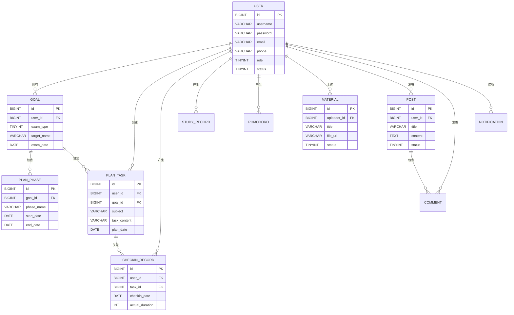

# 基于 SpringBoot 的考研考公规划与打卡系统

## 需求分析文档

| 项目名称 | 基于 SpringBoot 的考研考公规划与打卡系统 |
| --- | --- |
| 文档版本 | V1.1 |
| 编写日期 | 2026-10-09 |
| 编写人 | 郑欣宇 |
| 文档性质 | 软件工程综合实践——需求分析阶段交付物 |
| 密级 | 内部 |

---

## 1 引言

### 1.1 编写目的

本文档为"基于 SpringBoot 的考研考公规划与打卡系统"（以下简称"本系统"）的需求分析文档，旨在：

1. 明确系统的建设目标、业务范围与用户群体；
2. 完整、无歧义地描述系统的功能需求与非功能需求；
3. 作为后续概要设计、详细设计、编码实现、系统测试与验收的依据；
4. 为项目组、指导教师及评审人员提供评审与沟通的基础。

本文档面向的读者包括：项目开发人员、项目测试人员、指导教师、课程评审人员。

### 1.2 项目背景

近年来，考研、考公人数持续处于高位，备考周期普遍长达 6~12 个月。备考过程中，考生普遍面临以下问题：

1. **规划混乱**：缺乏科学的目标拆解方法，难以将长期目标转化为可执行的阶段计划与每日任务；
2. **执行力不足**：缺少有效的每日打卡与监督机制，容易中途放弃或"三天打鱼两天晒网"；
3. **数据无感知**：无法直观了解自己的学习时长、打卡率与科目进度，难以进行自我复盘；
4. **信息分散**：备考资料、经验分享散落在各类平台，缺乏面向考研考公场景的垂直聚合；
5. **缺乏同伴激励**：独学无友，缺少排行榜、打卡氛围等外部激励手段。

市面上通用的打卡与时间管理工具（如番茄钟、习惯养成类 App）虽具备基础打卡能力，但**不针对考研考公场景**：不支持目标院校/岗位管理、考试科目规划、考试倒计时、阶段计划等垂直功能。本系统面向公众开放，旨在填补这一细分缺口，为备考人群提供"目标—计划—执行—复盘"的一体化平台。

### 1.3 术语与缩略语

| 术语 | 说明 |
| --- | --- |
| 考研 | 全国硕士研究生招生考试 |
| 考公 | 公务员录用考试（含国考、省考、选调等） |
| 打卡 | 用户完成既定学习任务后，在系统中进行的确认记录行为 |
| 连续打卡 | 用户连续 N 天均有有效打卡记录，用于衡量执行连贯性 |
| 打卡率 | 统计周期内实际打卡天数与应打卡天数的比值 |
| 阶段计划 | 将备考周期划分为若干阶段（如基础、强化、冲刺）的计划 |
| 任务 | 可执行的最小学习单元（科目 + 内容 + 时长 + 日期） |
| 番茄钟 | 番茄工作法计时工具，默认 25 分钟一个专注时段 |
| 游客 | 未登录系统的访问者，可浏览公开内容 |
| 普通用户 | 完成注册并登录的用户，可使用全部个人功能 |
| 管理员 | 平台运营人员，负责用户管理、内容审核与数据统计 |
| UGC | User Generated Content，用户生成内容（如经验帖、资料） |
| UAT | User Acceptance Test，用户验收测试 |

### 1.4 参考资料

| 编号 | 参考资料 |
| --- | --- |
| [1] | 《软件工程综合实践》课程任务书与要求 |
| [2] | GB/T 8567-2006《计算机软件文档编制规范》 |
| [3] | GB/T 9385-2008《计算机软件需求规格说明规范》 |
| [4] | Spring Boot 官方文档（https://docs.spring.io/spring-boot/） |
| [5] | 《中华人民共和国个人信息保护法》 |

---

## 2 项目概述

### 2.1 项目目标

本系统建设目标如下：

1. 建设一个**面向公众开放**的考研考公规划与打卡 Web 平台，为备考人群提供一站式备考管理服务；
2. 实现"**目标管理 → 计划拆解 → 每日执行（打卡）→ 数据复盘**"的完整业务闭环；
3. 提供垂直化的备考场景能力：考试类型管理、目标院校/岗位、考试倒计时、科目化任务体系；
4. 构建轻量级备考社区：经验分享、备考资料聚合、打卡排行榜，形成同伴激励氛围；
5. 以 SpringBoot 为核心技术栈，产出结构清晰、可维护、可扩展、具备基本安全防护能力的生产级代码；
6. 作为软件工程综合实践项目，完整走通需求分析—设计—编码—测试—交付的软件工程流程。

### 2.2 项目范围

#### 2.2.1 系统边界

**本期建设范围（包含）**：

| 编号 | 范围 | 说明 |
| --- | --- | --- |
| 1 | 用户体系 | 注册、登录、个人信息管理、密码管理 |
| 2 | 目标与规划 | 备考目标创建、阶段计划、学习任务拆解、考试倒计时 |
| 3 | 打卡与执行 | 每日任务打卡、打卡日历、连续打卡、补卡、番茄钟 |
| 4 | 数据统计 | 个人学习统计、打卡率、科目进度、排行榜 |
| 5 | 资料与社区 | 备考资料库、经验分享帖、评论点赞、内容审核 |
| 6 | 消息提醒 | 任务提醒、倒计时提醒、断卡提醒、系统通知 |
| 7 | 管理后台 | 用户管理、内容审核、平台数据统计、系统公告 |

**本期不包含（明确排除）**：

| 编号 | 排除内容 | 说明 |
| --- | --- | --- |
| 1 | 在线课程/直播 | 不提供课程售卖与直播功能 |
| 2 | 支付与电商 | 不涉及任何在线支付、商品交易 |
| 3 | 原生移动端 App | 首期交付 Web 应用，采用响应式设计适配移动端浏览器 |
| 4 | 智能批改/AI 答题 | 首期不包含试卷批改、AI 答疑等能力 |
| 5 | 线下培训服务 | 不涉及培训机构接入与课程报名 |
| 6 | 第三方登录（微信/QQ） | 首期不接入，预留扩展接口 |

#### 2.2.2 部署形态

系统采用 B/S 架构，前后端分离：后端为 SpringBoot 单体应用，前端为 Vue 单页应用（首期可选），对外通过 HTTPS 提供服务。

### 2.3 用户特征

| 用户类型 | 特征描述 | 使用场景 | 熟练程度 |
| --- | --- | --- | --- |
| 备考学生 | 在校大学生，备考时间连续，习惯使用网络工具 | 每日打卡、制定计划、查看统计、浏览资料 | 较高 |
| 在职备考人员 | 碎片化时间学习，注重效率与提醒 | 打卡、番茄钟、消息提醒 | 中等 |
| 游客 | 未注册的访问者，先浏览后决定是否使用 | 浏览公开资料、经验帖、排行榜 | 不确定 |
| 管理员 | 平台运营人员 | 内容审核、用户管理、数据查看 | 较高 |

### 2.4 运行环境

| 项目 | 要求 |
| --- | --- |
| 客户端 | 主流浏览器（Chrome 84+、Edge 84+、Firefox 78+、Safari 14+），支持响应式布局，适配常见移动端浏览器 |
| 服务端 | JDK 17+、SpringBoot 3.x、MySQL 8.0+、Redis 6+ |
| 部署环境 | Linux 服务器（Ubuntu 20.04+ / CentOS 7+），Nginx 反向代理，HTTPS |
| 开发环境 | IntelliJ IDEA、Maven 3.8+、Git |

### 2.5 假设与依赖

1. 系统上线初期用户量级为百级并发，设计上预留水平扩展能力；
2. 用户注册采用邮箱 + 密码方式（邮箱验证码校验），首期不强制实名认证；手机号绑定与短信验证码预留接口，后续版本接入；
3. 用户上传的资料文件为常见格式（PDF、Word、图片），单文件大小上限 50MB；
4. 系统依赖第三方邮件服务（可选）发送通知，依赖 Redis 实现会话缓存与限流。

---

## 3 功能需求

### 3.1 角色与权限

系统共设三类角色：**游客（未登录）**、**普通用户**、**管理员**。

#### 3.1.1 角色权限矩阵

| 功能点 | 游客 | 普通用户 | 管理员 |
| --- | :-: | :-: | :-: |
| 浏览公开资料、经验帖、排行榜 | ✅ | ✅ | ✅ |
| 注册 / 登录 | ✅ | — | — |
| 创建/维护备考目标 | — | ✅ | — |
| 制定阶段计划与学习任务 | — | ✅ | — |
| 每日打卡 / 补卡 / 番茄钟 | — | ✅ | — |
| 查看个人统计与学习报告 | — | ✅ | — |
| 发布经验帖 / 上传资料 | — | ✅（待审核） | ✅（直接发布） |
| 评论、点赞 | — | ✅ | ✅ |
| 接收消息提醒 | — | ✅ | — |
| 用户管理（禁用/角色） | — | — | ✅ |
| 内容审核（帖子/资料） | — | — | ✅ |
| 平台数据统计、公告管理 | — | — | ✅ |

> 权限控制说明：后端基于 Spring Security + JWT 实现接口级鉴权；前端根据角色隐藏不可见入口；游客访问受限接口时返回 401，由前端引导登录。

### 3.2 总体功能结构

系统划分为七大功能模块，总体功能结构如下：

```mermaid
flowchart TB
    A[考研考公规划与打卡系统] --> B[用户管理模块]
    A --> C[目标规划模块]
    A --> D[打卡管理模块]
    A --> E[数据统计模块]
    A --> F[资料与社区模块]
    A --> G[消息提醒模块]
    A --> H[管理后台模块]

    B --> B1[注册/登录]
    B --> B2[个人信息]
    B --> B3[密码管理]

    C --> C1[备考目标]
    C --> C2[阶段计划]
    C --> C3[学习任务]
    C --> C4[考试倒计时]

    D --> D1[每日打卡]
    D --> D2[打卡日历]
    D --> D3[补卡]
    D --> D4[番茄钟]

    E --> E1[打卡统计]
    E --> E2[时长统计]
    E --> E3[科目进度]
    E --> E4[排行榜]

    F --> F1[资料库]
    F --> F2[经验分享帖]
    F --> F3[评论点赞]
    F --> F4[内容审核]

    G --> G1[任务提醒]
    G --> G2[倒计时提醒]
    G --> G3[断卡提醒]
    G --> G4[系统通知]

    H --> H1[用户管理]
    H --> H2[内容管理]
    H --> H3[平台统计]
    H --> H4[系统配置]
```

### 3.3 用例模型

#### 3.3.1 用例清单

| 编号 | 用例名称 | 主要参与者 | 优先级 |
| --- | --- | --- | --- |
| UC-01 | 用户注册 | 游客 | 高 |
| UC-02 | 用户登录 | 游客/普通用户 | 高 |
| UC-03 | 个人信息管理 | 普通用户 | 中 |
| UC-04 | 密码修改与找回 | 普通用户 | 中 |
| UC-05 | 创建备考目标 | 普通用户 | 高 |
| UC-06 | 制定阶段计划 | 普通用户 | 高 |
| UC-07 | 制定学习任务 | 普通用户 | 高 |
| UC-08 | 每日任务打卡 | 普通用户 | 高 |
| UC-09 | 打卡补签 | 普通用户 | 中 |
| UC-10 | 使用番茄钟 | 普通用户 | 中 |
| UC-11 | 查看个人学习统计 | 普通用户 | 高 |
| UC-12 | 查看打卡排行榜 | 游客/普通用户 | 低 |
| UC-13 | 浏览资料库 | 游客/普通用户 | 中 |
| UC-14 | 上传备考资料 | 普通用户 | 中 |
| UC-15 | 发布经验分享帖 | 普通用户 | 中 |
| UC-16 | 评论与点赞 | 普通用户 | 低 |
| UC-17 | 接收消息提醒 | 普通用户 | 中 |
| UC-18 | 用户管理 | 管理员 | 高 |
| UC-19 | 内容审核 | 管理员 | 高 |
| UC-20 | 平台数据统计 | 管理员 | 中 |
| UC-21 | 系统公告管理 | 管理员 | 低 |

#### 3.3.2 核心用例详细描述

**UC-01 用户注册**

| 项目 | 内容 |
| --- | --- |
| 用例名称 | 用户注册 |
| 参与者 | 游客 |
| 前置条件 | 游客访问注册页面 |
| 主流程 | ① 用户填写邮箱、用户名、密码（两次输入一致）；② 系统校验邮箱格式与唯一性、用户名唯一性、密码强度；③ 系统发送邮箱验证码；④ 用户输入验证码；⑤ 系统校验通过后创建账号，默认角色为"普通用户"；⑥ 注册成功，跳转登录页 |
| 异常流程 | 3a. 邮箱已被注册 → 提示"该邮箱已注册，可直接登录"；4a. 验证码错误或超时 → 提示重新获取；2a. 密码强度不足（长度 < 8 或缺少字母数字组合）→ 提示规则 |
| 后置条件 | 新账号创建成功，状态为"正常" |
| 业务规则 | BR-01：密码使用 BCrypt 加密存储，禁止明文；BR-02：验证码有效期 10 分钟，同账号 60 秒内不可重复发送；BR-03：同一 IP 每分钟注册请求不超过 10 次 |

**UC-02 用户登录**

| 项目 | 内容 |
| --- | --- |
| 用例名称 | 用户登录 |
| 参与者 | 游客 / 普通用户 |
| 前置条件 | 账号已注册 |
| 主流程 | ① 用户输入账号与密码；② 系统校验账号存在性与密码正确性；③ 校验通过后签发 JWT Token；④ 跳转系统首页/个人工作台 |
| 异常流程 | 2a. 密码错误连续 5 次 → 账号锁定 30 分钟，提示找回密码；2b. 账号被管理员禁用 → 提示"账号已被禁用，请联系管理员" |
| 后置条件 | 用户获得有效会话，可访问权限范围内功能 |
| 业务规则 | BR-04：Token 有效期 24 小时，支持"记住我"（7 天）；BR-05：登录失败需记录日志；BR-06：同一账号同一时刻允许多端登录 |

**UC-05 创建备考目标**

| 项目 | 内容 |
| --- | --- |
| 用例名称 | 创建备考目标 |
| 参与者 | 普通用户 |
| 前置条件 | 用户已登录 |
| 主流程 | ① 用户选择考试类型（考研/考公）；② 考研：填写报考层次（学硕/专硕）、目标院校、专业、考试科目（政治/外语/数学/专业课）、目标分数；考公：填写考试类型（国考/省考/选调）、目标岗位、考试科目（行测/申论等）；③ 填写预计考试日期；④ 系统自动计算并展示距考试剩余天数；⑤ 保存成功，进入规划引导 |
| 异常流程 | 4a. 考试日期早于当前日期 → 提示日期非法；2a. 目标院校/岗位为空 → 允许保存但标记为"待完善" |
| 后置条件 | 用户拥有一个"进行中"状态的备考目标 |
| 业务规则 | BR-07：同一用户最多同时存在 1 个"进行中"目标，可创建"已结束"历史目标用于复盘；BR-08：考试科目支持自定义增删，最多 6 门 |

**UC-08 每日任务打卡**

| 项目 | 内容 |
| --- | --- |
| 用例名称 | 每日任务打卡 |
| 参与者 | 普通用户 |
| 前置条件 | 用户已登录，且当日存在待完成任务 |
| 主流程 | ① 用户进入"今日任务"页面；② 系统按日期展示当日任务列表（科目、内容、预计时长）；③ 用户逐项确认完成并填写实际学习时长（可选备注）；④ 系统记录打卡信息，更新打卡日历与连续打卡天数；⑤ 全部任务完成后，提示"今日打卡完成"，可选生成打卡分享卡片 |
| 异常流程 | 4a. 补卡操作见 UC-09；3a. 实际时长超过预计时长 200% → 提示确认输入 |
| 后置条件 | 当日打卡记录生成；连续打卡天数、打卡率同步更新 |
| 业务规则 | BR-09：打卡记录以自然日（0:00–23:59）为粒度，同一任务当日仅可打卡一次；BR-10：未创建任务的日期不参与打卡率计算；BR-11：当日打卡完成后，次日 0 点自动开启新一轮 |

**UC-11 查看个人学习统计**

| 项目 | 内容 |
| --- | --- |
| 用例名称 | 查看个人学习统计 |
| 参与者 | 普通用户 |
| 前置条件 | 用户已登录 |
| 主流程 | ① 用户进入统计页面；② 系统展示本周打卡率、累计学习时长、连续打卡天数；③ 系统展示近 30 天学习时长趋势图与科目时长占比图；④ 系统展示各科目任务完成进度 |
| 异常流程 | 2a. 无学习数据 → 展示空状态引导文案"开始第一次打卡" |
| 后置条件 | 无 |
| 业务规则 | BR-12：统计数据基于打卡记录与学习记录实时计算，不做离线汇总；BR-13：趋势图支持按日/周/月切换 |

**UC-19 内容审核**

| 项目 | 内容 |
| --- | --- |
| 用例名称 | 内容审核 |
| 参与者 | 管理员 |
| 前置条件 | 管理员已登录后台 |
| 主流程 | ① 管理员进入审核队列；② 系统展示待审核的经验帖与资料（含上传者、时间、内容预览）；③ 管理员逐条审核，选择"通过"或"驳回"（驳回需填写原因）；④ 通过的内容发布至前台；驳回的内容通知上传者并附原因 |
| 异常流程 | 3a. 内容命中敏感词库 → 系统自动标记为"疑似违规"，优先置顶待审 |
| 后置条件 | 内容状态更新；上传者收到审核结果通知 |
| 业务规则 | BR-14：审核时限不超过 24 小时（自动提醒）；BR-15：被驳回内容可修改后重新提交，重新进入审核队列 |

> 其余用例（UC-03、04、06、07、09、10、12~18、20、21）的详细描述见附录 A。

### 3.4 功能模块需求详述

#### 3.4.1 用户管理模块

| 编号 | 功能点 | 需求描述 | 业务规则 |
| --- | --- | --- | --- |
| FR-01 | 用户注册 | 支持邮箱 + 邮箱验证码注册，用户名全局唯一；手机号绑定与短信验证码预留接口 | 用户名 2~20 字符，密码 ≥ 8 位且含字母和数字 |
| FR-02 | 用户登录 | 账号密码登录，支持"记住我" | 连续 5 次失败锁定 30 分钟 |
| FR-03 | 个人信息管理 | 维护头像（上传）、昵称、简介、备考方向 | 头像支持 JPG/PNG，≤ 2MB |
| FR-04 | 密码修改 | 登录后修改密码，需验证原密码 | 新密码不可与旧密码相同 |
| FR-05 | 密码找回 | 通过注册邮箱验证码重置密码（短信重置预留接口） | 同 UC-01 验证码规则 |
| FR-06 | 账号状态 | 管理员可禁用/启用账号 | 被禁用账号无法登录，数据保留 |

#### 3.4.2 目标规划模块

| 编号 | 功能点 | 需求描述 | 业务规则 |
| --- | --- | --- | --- |
| FR-07 | 备考目标管理 | 创建、编辑、结束、删除备考目标 | 进行中目标唯一；删除需二次确认 |
| FR-08 | 考试倒计时 | 按考试日期自动计算剩余天数，首页常驻展示 | 日期不可早于当前日期 |
| FR-09 | 阶段计划管理 | 按阶段（基础/强化/冲刺）设定起止时间与阶段目标，支持自定义阶段 | 阶段时间不可重叠 |
| FR-10 | 学习任务管理 | 按科目拆解学习任务：内容、计划日期、预计时长、优先级 | 任务可跨阶段引用；过期任务自动标记 |
| FR-11 | 计划模板 | 提供考研/考公常见备考计划模板一键套用 | 模板套用后生成用户自有任务，可再编辑 |
| FR-12 | 任务批量操作 | 支持按科目批量生成周任务、拖拽调整日期 | — |

#### 3.4.3 打卡管理模块

| 编号 | 功能点 | 需求描述 | 业务规则 |
| --- | --- | --- | --- |
| FR-13 | 每日打卡 | 按任务列表逐项打卡，记录实际时长与备注 | 当日任务当日打卡 |
| FR-14 | 打卡日历 | 月历视图展示每日打卡状态（完成/部分完成/未打卡） | 支持按月翻页 |
| FR-15 | 连续打卡 | 统计并展示连续打卡天数，中断即重新计数 | 以自然日为准 |
| FR-16 | 补卡 | 允许补签近 3 天内的漏卡记录，每月限 5 次 | 补卡仅记录时长，不影响连续打卡天数 |
| FR-17 | 番茄钟 | 内置 25 分钟专注计时，结束后自动记录学习时长 | 可自定义专注时长（15–60 分钟） |
| FR-18 | 打卡分享 | 生成打卡卡片（含连续天数、时长）供保存/分享 | 卡片不含敏感个人信息 |

#### 3.4.4 数据统计模块

| 编号 | 功能点 | 需求描述 | 业务规则 |
| --- | --- | --- | --- |
| FR-19 | 打卡统计 | 展示日/周/月打卡率与趋势 | 趋势图支持图表展示 |
| FR-20 | 时长统计 | 统计总学习时长、日均时长、各科目时长占比 | 数据来自打卡与番茄钟 |
| FR-21 | 科目进度 | 按科目展示任务完成率与剩余任务数 | — |
| FR-22 | 排行榜 | 按周/月展示打卡天数与学习时长排行 | 默认公开显示用户昵称，用户可选择"匿名上榜"（以匿名标识展示）；仅统计公开数据 |
| FR-23 | 学习报告 | 每周自动生成个人学习周报（可选推送） | 周报含打卡率、时长、建议 |

#### 3.4.5 资料与社区模块

| 编号 | 功能点 | 需求描述 | 业务规则 |
| --- | --- | --- | --- |
| FR-24 | 资料库 | 资料按考试类型/科目分类，支持检索、预览、下载 | 资料上传后先审核后发布 |
| FR-25 | 资料上传 | 用户上传 PDF/Word/图片资料，填写标题与分类 | 单文件 ≤ 50MB，格式受限 |
| FR-26 | 经验分享帖 | 发布备考经验帖（标题 + 正文），支持 Markdown 语法 | 发布后进入审核队列 |
| FR-27 | 评论与点赞 | 帖子支持评论与点赞，评论同样需过敏感词过滤 | 点赞每人每帖一次 |
| FR-28 | 内容审核 | 管理员审核帖子与资料，通过后前台可见 | 审核时限 ≤ 24h |
| FR-29 | 敏感词过滤 | 发布内容先经敏感词库过滤，命中则标记待审 | 敏感词库由管理员维护 |

#### 3.4.6 消息提醒模块

| 编号 | 功能点 | 需求描述 | 业务规则 |
| --- | --- | --- | --- |
| FR-30 | 任务提醒 | 每日定时提醒当日待办任务（站内消息 + 可选邮件） | 提醒时间可由用户设置 |
| FR-31 | 倒计时提醒 | 距考试 100 天 / 30 天 / 7 天时发送节点提醒 | — |
| FR-32 | 断卡提醒 | 连续 2 天未打卡时发送提醒 | 每日一次，不重复打扰 |
| FR-33 | 系统通知 | 审核结果、系统公告等站内通知 | 已读/未读状态管理 |
| FR-34 | 通知设置 | 用户可开关各类型通知 | 默认全部开启 |

#### 3.4.7 管理后台模块

| 编号 | 功能点 | 需求描述 | 业务规则 |
| --- | --- | --- | --- |
| FR-35 | 用户管理 | 查询用户、查看详情、禁用/启用、角色管理 | 操作留审计日志 |
| FR-36 | 内容管理 | 审核队列、已发布内容管理、违规内容下架 | 下架需填写原因 |
| FR-37 | 平台统计 | 用户总量、日活、打卡总数、内容总量等看板 | 数据每日 0 点汇总 |
| FR-38 | 系统配置 | 公告管理、敏感词库维护、文件上传限制配置 | 公告前台公告栏展示 |
| FR-39 | 操作审计 | 记录管理员关键操作（时间、操作人、对象、结果） | 日志保留 ≥ 180 天 |

---

## 4 非功能需求

### 4.1 性能需求

| 编号 | 指标 | 目标值 | 说明 |
| --- | --- | --- | --- |
| NFR-01 | 页面响应时间 | 普通页面 ≤ 2s，接口 P95 ≤ 500ms | 网络正常环境下 |
| NFR-02 | 并发支撑 | 支持 ≥ 100 并发在线用户 | 首期规模，预留扩展 |
| NFR-03 | 打卡接口吞吐 | ≥ 50 TPS | 高峰期打卡 |
| NFR-04 | 检索响应 | 资料/帖子检索 ≤ 1s | 万级数据量下 |
| NFR-05 | 可用性 | 年度可用性 ≥ 99.5% | — |
| NFR-06 | 图片加载 | 首页及列表页图片懒加载 | — |

### 4.2 安全需求

| 编号 | 需求 | 说明 |
| --- | --- | --- |
| NFR-07 | 密码安全 | 密码 BCrypt 加盐哈希存储，禁止明文存储与日志输出 |
| NFR-08 | 传输安全 | 全站 HTTPS；登录接口禁止 HTTP 明文 |
| NFR-09 | 认证与授权 | Spring Security + JWT；接口级权限控制，未授权返回 401/403 |
| NFR-10 | 防暴力破解 | 登录失败锁定、验证码、接口限流（Redis） |
| NFR-11 | 注入防护 | 参数校验 + 预编译 SQL，防止 SQL 注入；输出转义防 XSS |
| NFR-12 | 文件安全 | 上传文件类型/大小校验，重命名存储，禁止可执行文件 |
| NFR-13 | 数据脱敏 | 个人敏感信息（邮箱等）在界面展示时部分脱敏 |
| NFR-14 | 日志审计 | 登录、审核、禁用等关键操作记录日志 |
| NFR-15 | 个人信息保护 | 遵循《个人信息保护法》，注册协议明示收集范围；提供账号注销功能，注销后个人数据按规则删除/匿名化 |

### 4.3 可用性需求

| 编号 | 需求 | 说明 |
| --- | --- | --- |
| NFR-16 | 界面友好 | 界面简洁清晰，核心操作 ≤ 3 步完成 |
| NFR-17 | 响应式 | 适配桌面端与主流移动端浏览器 |
| NFR-18 | 空状态引导 | 无数据场景提供引导文案与操作入口 |
| NFR-19 | 错误提示 | 表单校验错误即时提示；操作失败给出可理解的原因 |
| NFR-20 | 帮助说明 | 提供新手引导（首次登录弹窗指引） |

### 4.4 可靠性需求

| 编号 | 需求 | 说明 |
| --- | --- | --- |
| NFR-21 | 数据备份 | 数据库每日全量备份，备份保留 ≥ 30 天 |
| NFR-22 | 容错 | 第三方服务（邮件等）不可用时系统降级运行，不影响核心功能 |
| NFR-23 | 幂等 | 打卡、点赞等写操作具备幂等性，防止重复提交 |
| NFR-24 | 事务 | 涉及多表写入的操作使用事务保证一致性 |

### 4.5 可维护性与可扩展性

| 编号 | 需求 | 说明 |
| --- | --- | --- |
| NFR-25 | 分层架构 | Controller–Service–Mapper 分层，职责清晰 |
| NFR-26 | 统一规范 | 统一异常处理、统一返回结构、统一命名规范 |
| NFR-27 | 配置外置 | 数据库、Redis 等配置通过配置文件/环境变量管理 |
| NFR-28 | 模块化 | 功能模块低耦合，预留移动端 API 扩展空间 |
| NFR-29 | 代码质量 | 核心逻辑单元测试覆盖率 ≥ 60% |

### 4.6 合规性需求

| 编号 | 需求 | 说明 |
| --- | --- | --- |
| NFR-30 | 内容合规 | UGC 内容先审后发，敏感词过滤，符合互联网内容管理要求 |
| NFR-31 | 隐私合规 | 隐私政策与用户协议在注册时展示并需同意 |

---

## 5 数据需求

### 5.1 数据实体与数据字典

系统核心数据实体共 12 个，主要实体及关键字段如下。

**1. 用户表（user）**

| 字段名 | 类型 | 约束 | 说明 |
| --- | --- | --- | --- |
| id | BIGINT | PK，自增 | 用户 ID |
| username | VARCHAR(20) | UNIQUE, NOT NULL | 用户名 |
| password | VARCHAR(100) | NOT NULL | BCrypt 密文 |
| email | VARCHAR(50) | 唯一, NOT NULL | 邮箱（登录凭证） |
| phone | VARCHAR(20) | 唯一, 可空 | 手机号（预留绑定，本期可空） |
| nickname | VARCHAR(30) | — | 昵称 |
| avatar_url | VARCHAR(255) | — | 头像地址 |
| intro | VARCHAR(200) | — | 个人简介 |
| exam_type | TINYINT | — | 备考方向（0 无/1 考研/2 考公） |
| role | TINYINT | NOT NULL, 默认 1 | 角色（0 管理员/1 普通用户） |
| status | TINYINT | NOT NULL, 默认 1 | 状态（0 禁用/1 正常） |
| create_time / update_time | DATETIME | NOT NULL | 创建/更新时间 |

**2. 备考目标表（goal）**

| 字段名 | 类型 | 约束 | 说明 |
| --- | --- | --- | --- |
| id | BIGINT | PK | 目标 ID |
| user_id | BIGINT | FK→user.id | 所属用户 |
| exam_type | TINYINT | NOT NULL | 1 考研 / 2 考公 |
| target_name | VARCHAR(100) | — | 目标院校/岗位 |
| major / position | VARCHAR(100) | — | 专业/岗位类型 |
| subjects | VARCHAR(200) | — | 考试科目（JSON 数组） |
| target_score | VARCHAR(50) | — | 目标分数/分数线 |
| exam_date | DATE | NOT NULL | 考试日期 |
| status | TINYINT | 默认 1 | 1 进行中/2 已结束 |
| create_time | DATETIME | NOT NULL | 创建时间 |

**3. 阶段计划表（plan_phase）**

| 字段名 | 类型 | 约束 | 说明 |
| --- | --- | --- | --- |
| id | BIGINT | PK | 阶段 ID |
| goal_id | BIGINT | FK→goal.id | 所属目标 |
| phase_name | VARCHAR(50) | NOT NULL | 阶段名（基础/强化/冲刺/自定义） |
| start_date / end_date | DATE | NOT NULL | 起止日期 |
| phase_target | VARCHAR(200) | — | 阶段目标描述 |

**4. 学习任务表（plan_task）**

| 字段名 | 类型 | 约束 | 说明 |
| --- | --- | --- | --- |
| id | BIGINT | PK | 任务 ID |
| user_id | BIGINT | FK→user.id | 所属用户 |
| goal_id | BIGINT | FK→goal.id | 所属目标 |
| phase_id | BIGINT | FK→plan_phase.id | 所属阶段（可空） |
| subject | VARCHAR(50) | NOT NULL | 科目 |
| task_content | VARCHAR(500) | NOT NULL | 任务内容 |
| plan_date | DATE | NOT NULL | 计划日期 |
| plan_duration | INT | — | 预计时长（分钟） |
| priority | TINYINT | 默认 2 | 1 高/2 中/3 低 |
| status | TINYINT | 默认 0 | 0 未开始/1 已完成/2 已过期 |

**5. 打卡记录表（checkin_record）**

| 字段名 | 类型 | 约束 | 说明 |
| --- | --- | --- | --- |
| id | BIGINT | PK | 记录 ID |
| user_id | BIGINT | FK→user.id | 用户 |
| task_id | BIGINT | FK→plan_task.id | 关联任务 |
| checkin_date | DATE | NOT NULL | 打卡日期 |
| actual_duration | INT | — | 实际时长（分钟） |
| note | VARCHAR(200) | — | 备注 |
| is_makeup | TINYINT | 默认 0 | 是否补卡（0 否/1 是） |
| create_time | DATETIME | NOT NULL | 打卡时间 |

**6. 学习记录表（study_record）**

| 字段名 | 类型 | 约束 | 说明 |
| --- | --- | --- | --- |
| id | BIGINT | PK | 记录 ID |
| user_id | BIGINT | FK→user.id | 用户 |
| subject | VARCHAR(50) | NOT NULL | 科目 |
| duration | INT | NOT NULL | 时长（分钟） |
| record_date | DATE | NOT NULL | 记录日期 |
| source | TINYINT | NOT NULL | 1 任务打卡/2 番茄钟/3 手动 |

**7. 番茄钟记录表（pomodoro）**

| 字段名 | 类型 | 约束 | 说明 |
| --- | --- | --- | --- |
| id | BIGINT | PK | 记录 ID |
| user_id | BIGINT | FK→user.id | 用户 |
| subject | VARCHAR(50) | — | 科目 |
| duration | INT | NOT NULL | 专注时长（分钟） |
| start_time / end_time | DATETIME | NOT NULL | 起止时间 |
| status | TINYINT | — | 1 完成/2 中断 |

**8. 资料表（material）**

| 字段名 | 类型 | 约束 | 说明 |
| --- | --- | --- | --- |
| id | BIGINT | PK | 资料 ID |
| title | VARCHAR(100) | NOT NULL | 标题 |
| category | VARCHAR(50) | NOT NULL | 分类（考试类型+科目） |
| file_url | VARCHAR(255) | NOT NULL | 文件地址 |
| uploader_id | BIGINT | FK→user.id | 上传者 |
| download_count | INT | 默认 0 | 下载次数 |
| status | TINYINT | 默认 0 | 0 待审核/1 已发布/2 已下架 |
| create_time | DATETIME | NOT NULL | 上传时间 |

**9. 帖子表（post）**

| 字段名 | 类型 | 约束 | 说明 |
| --- | --- | --- | --- |
| id | BIGINT | PK | 帖子 ID |
| user_id | BIGINT | FK→user.id | 作者 |
| title | VARCHAR(100) | NOT NULL | 标题 |
| content | TEXT | NOT NULL | 正文 |
| like_count / comment_count | INT | 默认 0 | 点赞数/评论数 |
| status | TINYINT | 默认 0 | 0 待审核/1 已发布/2 已下架 |
| create_time | DATETIME | NOT NULL | 发布时间 |

**10. 评论表（comment）**：id、post_id（FK）、user_id（FK）、content、create_time。

**11. 通知表（notification）**：id、user_id（FK）、type（TINYINT：1 任务提醒/2 倒计时/3 断卡/4 审核结果/5 公告）、content、is_read（TINYINT）、create_time。

**12. 操作日志表（audit_log）**：id、operator_id（FK）、action、target_type、target_id、detail、create_time。

### 5.2 实体关系（ER）

### 5.3 数据存储与备份

1. 关系数据存储于 MySQL，采用 InnoDB 引擎、utf8mb4 字符集；
2. 热点数据（会话、限流计数、排行榜缓存）存储于 Redis；
3. 上传文件存储于服务器本地磁盘（或对象存储），数据库中仅保存访问路径；
4. 数据库每日全量备份（mysqldump），备份文件保留 ≥ 30 天；
5. 用户注销后，其个人隐私字段匿名化处理，业务数据按平台规则保留。

---

## 6 界面需求

### 6.1 总体界面风格

1. 整体风格简洁、清爽，主色调建议使用低饱和度的蓝绿色系，营造"专注、向上"的备考氛围；
2. 布局采用顶部导航 + 左侧功能栏 + 主内容区的经典结构；移动端自动折叠为底部 Tab 导航；
3. 关键数据（倒计时、连续打卡天数）以大号数字突出展示，强化激励感；
4. 打卡成功、任务完成等正向反馈提供轻量动效与提示。

### 6.2 主要页面说明

| 页面 | 功能说明 |
| --- | --- |
| 首页 | 展示系统简介、备考倒计时卡片（登录后）、今日任务概览、公开排行榜、公告栏 |
| 注册/登录页 | 账号注册、登录、找回密码入口 |
| 个人工作台 | 今日任务、快速打卡、番茄钟入口、倒计时、连续打卡天数 |
| 目标规划页 | 备考目标信息、阶段计划时间轴、考试倒计时 |
| 任务管理页 | 按日期/科目查看与维护学习任务，支持批量操作 |
| 打卡日历页 | 月历视图展示打卡状态，可点击日期查看详情与补卡 |
| 数据统计页 | 打卡率、时长趋势、科目占比图表 |
| 资料库页 | 资料分类浏览、检索、上传入口 |
| 社区页 | 经验帖列表、详情（含评论点赞）、发帖入口 |
| 消息中心 | 各类通知列表与已读/未读管理 |
| 管理后台 | 用户管理、审核队列、平台统计看板、系统配置 |

---

## 7 约束与验收标准

### 7.1 技术与设计约束

1. 后端采用 SpringBoot 3.x + MyBatis-Plus + MySQL + Redis；
2. 认证采用 Spring Security + JWT；
3. 前端采用 Vue 3 + Element Plus（响应式）；
4. 前后端分离，接口遵循 RESTful 风格，统一返回结构 `{code, message, data}`；
5. 项目使用 Git 进行版本管理，代码托管于 GitHub 远程仓库；
6. 开发过程遵循软件工程规范：需求分析 → 概要设计 → 详细设计 → 编码 → 测试 → 验收。

### 7.2 验收标准

| 编号 | 验收项 | 标准 |
| --- | --- | --- |
| AC-01 | 功能完整性 | 3.4 节全部功能点（FR-01~FR-39）实现并通过功能测试 |
| AC-02 | 角色权限 | 三类角色权限矩阵与 3.1 节一致，越权访问被拦截 |
| AC-03 | 安全 | 通过安全用例测试：SQL 注入、XSS、越权、暴力破解防护生效 |
| AC-04 | 性能 | 满足 4.1 节性能指标 |
| AC-05 | 数据 | 核心业务数据无丢失，打卡统计结果可手工复算一致 |
| AC-06 | 文档 | 需求、设计、测试文档齐全，代码有注释与 README |
| AC-07 | 演示 | 可通过演示环境完整走通"注册→建目标→定计划→打卡→看统计"主流程 |

---

## 8 附录

### 附录 A：其余用例详细描述（简表）

| 编号 | 用例 | 前置条件 | 主流程简述 | 关键业务规则 |
| --- | --- | --- | --- | --- |
| UC-03 | 个人信息管理 | 已登录 | 编辑昵称/简介/头像/备考方向 → 保存 | 头像 ≤ 2MB |
| UC-04 | 密码修改与找回 | 已登录/游客 | 验证原密码或验证码 → 设置新密码 | 新密码不与旧密码相同 |
| UC-06 | 制定阶段计划 | 已有目标 | 新增阶段 → 填起止时间与目标 → 保存 | 阶段时间不可重叠 |
| UC-07 | 制定学习任务 | 已有目标/阶段 | 选科目 → 填内容、日期、时长 → 保存/批量生成 | 任务可批量生成 |
| UC-09 | 打卡补签 | 已登录 | 选择近 3 天漏卡日期 → 填写记录 → 确认补卡 | 每月限 5 次，不影响连续天数 |
| UC-10 | 使用番茄钟 | 已登录 | 选科目 → 开始计时 → 结束/中断 → 写入学习记录 | 时长 15–60 分钟 |
| UC-12 | 查看排行榜 | 游客/登录 | 选择周期与维度 → 查看排行 | 支持匿名模式 |
| UC-13 | 浏览资料库 | 游客/登录 | 按分类检索 → 预览/下载 | 仅已发布资料可见 |
| UC-14 | 上传备考资料 | 已登录 | 填标题分类 → 上传文件 → 提交审核 | 文件 ≤ 50MB |
| UC-15 | 发布经验帖 | 已登录 | 编辑标题正文 → 提交 → 进入审核 | 命中敏感词自动标记 |
| UC-16 | 评论与点赞 | 已登录 | 发表评论/点赞 → 展示 | 点赞每人每帖一次 |
| UC-17 | 接收消息提醒 | 已登录 | 系统按规则推送 → 消息中心查看 | 各类型可独立开关 |
| UC-18 | 用户管理 | 管理员 | 搜索用户 → 查看/禁用/改角色 | 操作留审计日志 |
| UC-20 | 平台数据统计 | 管理员 | 查看用户/打卡/内容统计看板 | 每日 0 点汇总 |
| UC-21 | 系统公告管理 | 管理员 | 新增/编辑/下线公告 | 前台公告栏展示 |

### 附录 B：功能需求追溯表

| 功能编号 | 模块 | 用例 | 优先级 |
| --- | --- | --- | --- |
| FR-01~06 | 用户管理 | UC-01~04 | 高 |
| FR-07~12 | 目标规划 | UC-05~07 | 高 |
| FR-13~18 | 打卡管理 | UC-08~10 | 高 |
| FR-19~23 | 数据统计 | UC-11~12 | 高 |
| FR-24~29 | 资料与社区 | UC-13~16、UC-19 | 中 |
| FR-30~34 | 消息提醒 | UC-17 | 中 |
| FR-35~39 | 管理后台 | UC-18、UC-20~21 | 高 |

### 附录 C：需求决策记录

> 原"待确认问题"已按建议方案确认，决策如下，后续开发严格按此执行。

| 编号 | 决策项 | 已确认决策 |
| --- | --- | --- |
| Q-01 | 手机号短信验证码 | 首期仅邮箱验证码，手机号绑定与短信验证码预留接口，后续版本接入 |
| Q-02 | 排行榜是否公开展示用户昵称 | 默认公开显示昵称，用户可选择"匿名上榜" |
| Q-03 | 是否接入第三方登录（微信/QQ） | 首期不接入，预留扩展接口 |
| Q-04 | 前端是否由本项目组自行实现 | 由本项目组自行实现（Vue 3），保证完整闭环 |

---

> 本文档为 V1.1 版本，后续根据评审意见与开发过程中的需求变更进行修订，修订记录见下表。

**修订记录**

| 版本 | 修订日期 | 修订人 | 修订说明 |
| --- | --- | --- | --- |
| V1.0 | 2026-10-09 | 郑欣宇 | 初稿 |
| V1.1 | 2026-10-09 | 郑欣宇 | 附录 C 待确认问题按建议方案确认；同步修订注册/登录凭证为邮箱验证码（短信预留）、排行榜匿名选项、第三方登录排除、前端实现方式等对应章节 |
